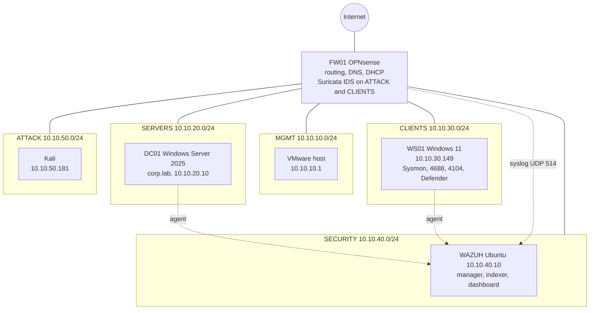

# Wazuh Detection Engineering Lab

[](https://github.com/tdinh-dev-sec-scientist/wazuh-detection-engineering-lab/actions/workflows/validate.yml)
[](https://github.com/tdinh-dev-sec-scientist/wazuh-detection-engineering-lab/actions/workflows/engine.yml)


A home SOC lab where I attack a Windows domain, check what Wazuh detects out of the box, and write rules for what it misses. Every rule has a test, a screenshot of the alert, and a note on what it does not catch.

| | |
| --- | --- |
| Attack simulations | 15, mostly Atomic Red Team on a domain-joined Windows 11 workstation |
| Custom detections | 23 Wazuh rules and 1 decoder (IDs 100100 to 100722) |
| Gaps closed | 11 techniques where the defaults missed, mislabeled or under-rated the activity |
| Already covered | 4 techniques the default ruleset handled, confirmed and documented |
| Evidence | 54 screenshots linked from the [evidence log](docs/detection-evidence-log.md) |
| Verification | Three levels: 47 pattern samples, 78 engine cases (22 on real captured events, 56 synthetic) run inside a real Wazuh 4.14.8 manager on every push, and live attack tests with screenshots. [How and where each rule is verified](docs/detection-quality.md) |

## Read these first

The cases below changed how I write rules. Each one links to the evidence.

- **First match wins.** Rules that share a parent are evaluated in file order. My net.exe account rule shadowed the group rule until I reordered and tightened them. [Details](docs/detection-evidence-log.md#review-fixes-rule-order-and-escaped-quotes)
- **Wazuh stores command lines escaped.** Quotes arrive as `\"` and backslashes arrive doubled, so anchored patterns silently stop matching. I confirmed the stored form by decoding a real event with `wazuh-logtest`. [Details](docs/detection-evidence-log.md#t1021002-smbwindows-admin-shares)
- **A blocked process can vanish from Sysmon.** Defender stopped `certutil` at process creation, Sysmon logged nothing, and the Sysmon rule stayed silent. Security event 4688 still recorded the launcher, so each such rule has a 4688 twin. [Details](docs/detection-evidence-log.md#why-rule-100700-stayed-silent)
- **Image-path rules miss renamed binaries.** Copies of `systeminfo.exe`, `schtasks.exe` and `wevtutil.exe` under other names evaded the first rules. Rules 100101, 100501 and 100552 match the original file name from the PE header. [Details](docs/detection-evidence-log.md#renamed-binaries)
- **`wazuh-logtest` cannot run Windows rules.** It skips the eventchannel decoder, so a pasted Windows event falls to a generic syslog rule. I found this in the Wazuh source and test the rules in a real manager the way Wazuh's own ruleset tests do. [Details](docs/detection-quality.md#how-a-rule-is-verified)
- **Thresholds need a boundary test.** The mass account creation rule stays silent at 9 accounts in 60 seconds and fires at 10. [Details](docs/detection-evidence-log.md#boundary-test)

## Analyst view

- [Investigation cases](docs/investigation-cases.md): four alerts triaged with timeline, context, disposition, impact and remediation.
- [Attack chain timeline](docs/attack-chain-timeline.md): one live session compared step by step across the endpoint log and Wazuh, with delays, two misses and the likely cause.
- [What the architecture buys](docs/architecture-chain.md): the path of a scan and a brute force from Kali through FW01 and WS01 to Wazuh, and which layer caught which.
- [Detection quality](docs/detection-quality.md): expected against observed results, negative tests and known misses.

## Lab



The lab runs in VMware Fusion Pro on an Intel MacBook Pro. Each segment is an isolated VMware network, and OPNsense routes and filters between them.

| Host | Role | OS |
| --- | --- | --- |
| FW01 | Firewall, DNS, DHCP, segment routing, Suricata | OPNsense |
| DC01 | Domain controller for corp.lab | Windows Server 2025 |
| WS01 | Domain-joined workstation, target of all Atomic tests | Windows 11 Enterprise |
| WAZUH | SIEM (manager, indexer, dashboard), Wazuh 4.14.8 | Ubuntu Server |
| Kali | Attacker box, powered on only when needed | Kali Linux |

Log sources on DC01 and WS01 reach Wazuh through the Wazuh agent: Sysmon (sysmon-modular configuration, deployed by GPO), Security event 4688 with command line, and PowerShell script block logging (event 4104), all enabled by GPO. Atomic Red Team is installed on WS01 only, with a Defender exclusion on `C:\AtomicRedTeam`, and the Atomic tests run locally there. Kali is used only for the two network tests, the nmap scan and the SMB logon failures.

## Coverage

| Technique | Default rules | Custom rule | Gap that remains |
| --- | --- | --- | --- |
| T1082 System Information Discovery | No alert | 100100, 100101 | Only `systeminfo.exe` and renamed copies of it are matched |
| Firewall blocks between segments | Rule 87701 never alerts | 100200 | Allowed traffic is not logged as an alert |
| T1046 Network Service Discovery | Suricata logs not decoded | 100300, 100301 | One alert per scan packet, no grouping |
| T1136.002 Domain Account Creation | 60109 for single accounts | 100400 | Fires at 10 accounts in 60 seconds, not at 9; the threshold is fixed |
| T1053.005 Scheduled Task | Generic level 3 | 100500, 100501 | `/create` and `-create`, not `/delete` |
| T1547.001 Registry Run Keys | 92302, level 6 | None needed | None found in this test |
| T1136.001 Local Account Creation | 60109 with the wrong technique | 100450 | Local accounts only |
| T1070.001 Clear Windows Event Logs | 63104, T1070 only (no sub-technique) | 100550, 100551, 100552 | `wevtutil.exe` is the only process matched, renamed copies included |
| T1110 Brute Force | 60122 and 60204, T1110 | None needed | Parent technique only, one source and one account tested |
| T1059.001 PowerShell | 92057, level 12, T1059.001 | None needed | One encoded command tested; script block text (event 4104) not alerted |
| T1087.001 Local Account Discovery | 92033, 92036, 92032 at level 3, no T1087.001 | 100600 to 100603 | Process commands only; PowerShell cmdlets such as Get-LocalUser are not matched |
| T1069.001 Permission Groups Discovery: Local Groups | Generic level 3 alerts (92032, 92033, 92036); the technique ID was not queried | 100601 | net localgroup and net group only; PowerShell Get-LocalGroup is not matched |
| T1555.004 Credentials from Password Stores: Windows Credential Manager | Generic level 3 alerts (92032); the technique ID was not queried | 100602 | cmdkey /list only; other ways to read stored credentials are not matched |
| T1033 System Owner/User Discovery | Generic level 3 alerts (92032); the technique ID was not queried | 100603 | query user and quser only; whoami.exe is not matched |
| T1105 Ingress Tool Transfer | 67027, level 3, no technique; Defender block alerts at level 12 (62123) once the agent collects its channel | 100700, 100701 | Only certutil -urlcache and -verifyctl matched; when Defender blocks the process only 100701 fires |
| T1021.002 SMB/Windows Admin Shares | 92052 (level 4) and 67027 (level 3), no T1021.002 | 100710, 100711 | Command lines only, tested against the local share; share access events 5140 and 5145 raised no alert |
| T1543.003 Windows Service | 61138 (level 5) and 92307 (level 3), T1543.003 | None needed | Levels are low; only service creation with sc.exe was tested |
| T1218 System Binary Proxy Execution | No alert with the technique | 100720, 100721, 100722 | 100720 and 100721 match wlrmdr.exe with -u; 100722 matches its child processes in the Security log only |

The same data as an [ATT&CK Navigator layer](mitre/attack-navigator-layer.json): open the [Navigator](https://mitre-attack.github.io/attack-navigator/), choose **Open Existing Layer**, then **Upload from local**. Green is a custom rule, blue is a technique the defaults already covered. A per-rule view is in the [rule catalog](docs/rule-catalog.md), and one row per test is in the [test matrix](docs/test-matrix.md).

## How each test ran

1. Run the technique on WS01, for example `Invoke-AtomicTest T1218 -TestNumbers 16`.
2. Query Wazuh Threat Hunting for what the default rules did. That view only shows events that alerted, so I also checked the raw Sysmon and Security events on WS01 to see whether the activity was logged at all.
3. Where the defaults missed, write a rule, run `wazuh-analysisd -t`, restart the manager, rerun the test and capture the alert.
4. Open the alert details to confirm the technique fields, and write down what the rule does not catch.

## Repository layout

```
rules/local_rules.xml          23 custom rules
decoders/local_decoder.xml     Suricata EVE JSON decoder
configs/                       Agent setting that collects Microsoft Defender events
docs/detection-evidence-log.md Full write-up, one section per test, with screenshots
docs/detection-quality.md      How each rule is verified, expected against observed, known misses
docs/investigation-cases.md   Four alerts triaged like an analyst would
docs/architecture-chain.md     Path of an attack through the segments and detection layers
docs/rule-catalog.md           Every rule with level, technique, log source and evidence link
docs/test-matrix.md            One row per test
mitre/                         ATT&CK Navigator layer
screenshots/                   Evidence for every claim in the log
scripts/validate_repo.py       Consistency checks used by CI
scripts/prepare_engine_tests.py  Makes a throwaway manager accept Windows events in logtest
scripts/extract_fixtures.py    Captures real events from Wazuh alerts as test fixtures
scripts/chain_timeline.py      Alert timeline for a time window
scripts/Export-ChainEvents.ps1 What a Windows endpoint logged in a time window
tests/                         Pattern samples (tests/cases.py) and engine tests (tests/engine/)
```

## Use the rules

On the Wazuh manager:

```bash
sudo cp rules/local_rules.xml /var/ossec/etc/rules/local_rules.xml
sudo cp decoders/local_decoder.xml /var/ossec/etc/decoders/local_decoder.xml
sudo /var/ossec/bin/wazuh-analysisd -t; echo "exit code: $?"
sudo systemctl restart wazuh-manager
```

`wazuh-analysisd -t` prints nothing on success, so check the exit code. Back up your existing `local_rules.xml` first, because the copy replaces it. Two values are specific to my lab: the `10.10.0.0/16` range in rule 100200 and the NetBIOS domain name `CORP` in rule 100450.

To check the repository locally:

```bash
python3 scripts/validate_repo.py
python3 -m unittest discover -s tests -v
```

The pattern tests run each rule's field patterns against sample events in the form Wazuh stores them, including harmless near misses. They use Python's `re` in place of PCRE2 and do not evaluate parent conditions such as `if_group`. The engine workflow closes that gap: it installs Wazuh 4.14.8, loads the rules and sends every sample through the real `wazuh-analysisd`, including the frequency rule at 9 and 10 accounts. To run it on a test VM with a manager installed, apply `scripts/prepare_engine_tests.py`, then `sudo python3 tests/engine/run_engine_tests.py`.

## Limits

- Each test was run once or a few times in a lab. This is not a measured false positive rate. A short check with harmless commands is in the evidence log.
- Several rules alert on every use of a tool, so legitimate admin work will also fire them. Each section of the log lists how to narrow that.
- The rules match process command lines. The same actions through PowerShell cmdlets or APIs are not covered.
- The renamed binary rules trust the original file name in the version resource. I did not test a copy with a modified resource.

## Author

Truong Dinh, B.S. Cybersecurity at the University of South Florida. [LinkedIn](https://www.linkedin.com/in/tdinh123) | [GitHub](https://github.com/tdinh-dev-sec-scientist)

Released under the [MIT License](LICENSE).
