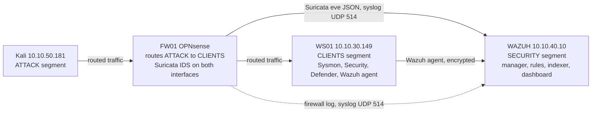

# What the architecture buys: an event's path end to end

A single Wazuh server with no agents would still catch some of this lab's tests, through syslog alone. What the five-segment architecture adds is traced here with two real tests from the evidence log that both run from Kali (10.10.50.181, the ATTACK segment) against WS01 (10.10.30.149, the CLIENTS segment): the nmap scan ([T1046](detection-evidence-log.md#suricata-network-detection)) and the SMB brute force ([T1110](detection-evidence-log.md#t1110-brute-force-over-smb)). They were run as separate tests on the same day, not one continuous session; this page lines them up to show how the pieces work together, not to claim they happened as one incident.

## The path a packet takes

Three independent paths reach the SECURITY segment for the same attacker action: the firewall's own log, Suricata's inspection of the same traffic, and the target host's own telemetry. Losing any one still leaves the others.

## Stage 1: Network Service Discovery (T1046)

| Layer | What happened | Evidence |
| --- | --- | --- |
| Wire | `nmap -sS -Pn -T4 -p 22,1433,3306,5432,1521,5900` from Kali to WS01 | [test](detection-evidence-log.md#suricata-network-detection) |
| FW01 | OPNsense routes the packets from ATTACK to CLIENTS; Suricata inspects both interfaces and raises 21 ET SCAN alerts locally, then forwards them as eve JSON over syslog | screenshot `suricata-1-opnsense-alerts.png` |
| WAZUH, before the custom rule | No decoder matched the Suricata JSON line; the event fell to rule 1002 ("Unknown problem somewhere in the system"), level 2. A SIEM running without the custom decoder would show this scan as unclassified noise | section "Gap: no decoder for the syslog line" |
| WAZUH, after rules 100300/100301 | 16 alerts, level 7, `rule.id: 100301`, each naming the signature, source and destination | section "Result" |
| WS01's own telemetry | Not checked for this test. I did not look. A SYN scan that never completes a handshake may leave little in Security or Sysmon logs |  |

What the architecture contributed here: the firewall segment is the only place this stage is visible at all. WS01 was not expected to log a port scan, and did not. Without Suricata on FW01, this stage would have produced zero detections.

## Stage 2: Brute Force over SMB (T1110)

| Layer | What happened | Evidence |
| --- | --- | --- |
| Wire | 12 failed SMB logons, `smbclient -L //10.10.30.149 -U 'fakeuser%WrongPass123'`, from the same Kali host | [test](detection-evidence-log.md#t1110-brute-force-over-smb) |
| FW01 | The first 12 attempts timed out: OPNsense logged `match,pass,out` (the firewall passed the traffic), and WS01 dropped it, most likely at Windows Defender Firewall. Because the firewall did not block it, rule 100200 (which only matches blocked packets) never fired for this stage, and only the `emerging-scan` rule set is enabled on Suricata, so neither network layer raised an alert for it. SMB had to be opened on WS01 for Kali's IP with a temporary rule before the test could reach the logon stage at all | "Setup note" in the T1110 section |
| WS01 | Once reachable, Security event 4625 recorded all 12 failures: source IP 10.10.50.181, workstation KALI, target user `fakeuser`, logon type 3, NTLM, status `0xc000006d` | section "Result: coverage by default rules" |
| WAZUH | 11 alerts from rule 60122 (level 5) and one from rule 60204 (level 10, "Multiple Windows Logon Failures") at 18:15:42, already carrying `rule.mitre.id` T1110. No custom rule was needed | same section |

What the architecture contributed here: the opposite lesson from stage 1. The firewall and IDS layer saw nothing useful for this stage (the traffic was allowed, and no enabled Suricata signature covers it), so the only detection came from the endpoint's own Security log reaching Wazuh through the agent. A design that relied on network-layer detection alone would have missed this stage entirely.

## Reading the two stages together

| Question | T1046 (scan) | T1110 (brute force) |
| --- | --- | --- |
| Detected at the firewall/IDS layer? | Yes, this is the only layer that caught it | No enabled signature, and the traffic was allowed through |
| Detected at the endpoint? | Not checked, and a SYN scan that never completes a handshake may leave little in host logs | Yes, Security event 4625 on WS01 |
| Needed a custom rule? | Yes (100300/100301, decoder was missing) | No, default rule 60204 already maps to T1110 |
| What a single detection layer would have missed | Everything, if only the endpoint agent existed | Everything, if only firewall/IDS existed |

This is the point of running Suricata on the firewall and Sysmon/Security auditing on the endpoint rather than one or the other: each test in this lab was caught by exactly one of the two layers, and the technique decided which one. A network reconnaissance step is visible on the wire and invisible on a host that never completes the handshake; a credential-guessing step against SMB is visible on the target host's authentication log and often invisible on the wire once the firewall allows the session through.

## What is still missing from this chain

- No single alert links these two stages together as one actor's campaign. Wazuh here treats them as independent events; correlating "same source IP, scan followed by brute force within N minutes" would need either a dedicated correlation rule or a case-management layer on top of Wazuh, and this lab has neither.
- Stage 1's SYN scan was never checked against WS01's own event log, so whether the target host logged anything for the scan itself is unknown, not confirmed absent.
- The two tests ran hours apart in the same day, each set up by hand, so this page assembles them into a narrative; it does not demonstrate Wazuh correlating a live, continuous intrusion.
