# Home SOC Lab: Detection Evidence Log

Truong Dinh, University of South Florida

Attack simulations against the lab, mostly Atomic Red Team tests on WS01, the Wazuh alerts they produced, and the custom rules written where the defaults missed.

I ran fifteen tests against this lab and checked what Wazuh 4.14.8 alerts on out of the box. In eleven of them the default rules missed the activity, gave it no matching technique, or gave it the wrong one, so I wrote twenty-three custom rules and one decoder. Four techniques, T1547.001, T1110, T1059.001 and T1543.003, were already covered.

## Coverage at a glance

| Technique | Default rules | Custom rule | Gap that remains |
| --- | --- | --- | --- |
| T1082 System Information Discovery | No alert | 100100, 100101 | Only `systeminfo.exe` and renamed copies of it are matched |
| Firewall blocks between segments | Rule 87701 never alerts | 100200 | Allowed traffic is not logged as an alert |
| T1046 Network Service Discovery | Suricata logs not decoded | 100300, 100301 | One alert per scan packet, no grouping |
| T1136.002 Domain Account Creation | 60109 for single accounts | 100400 | Fires at 10 accounts in 60 seconds, not at 9; the threshold is fixed |
| T1053.005 Scheduled Task | Generic level 3 | 100500, 100501 | `/create` and `-create`, not `/delete` |
| T1547.001 Registry Run Keys | 92302, level 6 | None needed | None found in this test |
| T1136.001 Local Account Creation | 60109 with the wrong technique; 92040 (level 12) on the `net user /add` command line | 100450 | Local accounts only |
| T1070.001 Clear Windows Event Logs | 63104, T1070 only (no sub-technique) | 100550, 100551, 100552 | `wevtutil.exe` is the only process matched, renamed copies included |
| T1110 Brute Force | 60204, T1110 (60122 maps T1531) | None needed | Parent technique only, one source and one account tested |
| T1059.001 PowerShell | 92057, level 12, T1059.001 | None needed | One encoded command tested; script block text (event 4104) not alerted |
| T1087.001 Local Account Discovery | 92033, 92036, 92032 at level 3, no T1087.001 | 100600 to 100603 | Process commands only; PowerShell cmdlets such as Get-LocalUser are not matched |
| T1069.001 Permission Groups Discovery: Local Groups | Generic level 3 alerts (92032, 92033, 92036); the technique ID was not queried | 100601 | net localgroup and net group only; PowerShell Get-LocalGroup is not matched |
| T1555.004 Credentials from Password Stores: Windows Credential Manager | Generic level 3 alerts (92032); the technique ID was not queried | 100602 | cmdkey /list only; other ways to read stored credentials are not matched |
| T1033 System Owner/User Discovery | Generic level 3 alerts (92032); the technique ID was not queried | 100603 | query user and quser only; whoami.exe is not matched |
| T1105 Ingress Tool Transfer | 67027, level 3, no technique; Defender block alerts at level 12 (62123) once the agent collects its channel | 100700, 100701 | Only certutil -urlcache and -verifyctl matched; when Defender blocks the process only 100701 fires |
| T1021.002 SMB/Windows Admin Shares | 92052 (level 4) and 67027 (level 3), no T1021.002 | 100710, 100711 | Command lines only, tested against the local share; share access events 5140 and 5145 raised no alert |
| T1543.003 Windows Service | 61138 (level 5) and 92307 (level 3), T1543.003 | None needed | Levels are low; only service creation with sc.exe was tested |
| T1218 System Binary Proxy Execution | No alert with the technique | 100720, 100721, 100722 | 100720 and 100721 match wlrmdr.exe with -u; 100722 matches its child processes in the Security log only |

## Lab environment

The lab runs in VMware Fusion Pro on an Intel MacBook Pro, with five isolated network segments routed through an OPNsense firewall.

| Host | Role | OS |
| --- | --- | --- |
| FW01 | Firewall, DNS, DHCP, segment routing | OPNsense |
| DC01 | Domain controller for corp.lab | Windows Server 2025 |
| WS01 | Domain-joined workstation, target of all Atomic tests | Windows 11 Enterprise |
| WAZUH | SIEM (manager, indexer, dashboard), Wazuh 4.14.8 | Ubuntu Server |
| Kali | Attacker box, powered on only when needed | Kali Linux |

Log sources reaching Wazuh from DC01 and WS01 through the Wazuh agent:

- Sysmon, deployed by GPO with the sysmon-modular configuration
- Security event 4688 with command line, enabled by GPO
- PowerShell script block logging (event 4104), enabled by GPO

Atomic Red Team is installed on WS01 only, with a Defender exclusion on `C:\AtomicRedTeam`.

## Test summary

One row per test, newest first.

| Date | Technique | Atomic test | Log source | Rule | Result |
| --- | --- | --- | --- | --- | --- |
| 2026-10-15 | T1218 System Binary Proxy Execution | T1218-16, Wlrmdr LOLBin launching calc.exe | Sysmon event 1 and Security event 4688 on WS01 | Custom 100720, 100721 and 100722 (level 8) | Default rules gave no T1218 alert; both custom rules detect the command and map it to T1218 |
| 2026-10-15 | T1543.003 Create or Modify System Process: Windows Service | T1543.003-2, service installation with sc.exe | System event 7045, registry and process creation events on WS01 | Default 61138 (level 5) and 92307 (level 3) | Already detected and mapped to T1543.003 at levels 5 and 3; no custom rule needed |
| 2026-10-15 | T1021.002 Remote Services: SMB/Windows Admin Shares | T1021.002-4, execute command writing output to local Admin Share | Sysmon event 1 and Security event 4688 on WS01 | Default 92052 (level 4) and 67027 (level 3); custom 100710 and 100711 (level 6) | The command ran and wrote to ADMIN$; the defaults alerted at levels 3 and 4 with no technique; the custom rules alert at level 6 |
| 2026-10-15 | T1105 Ingress Tool Transfer | T1105-7, certutil download (urlcache) | Security event 4688 on WS01 | Default 67027 (level 3); custom 100701 (level 8) | Defender blocked the command and rule 62123 alerted at level 12 once the agent collected the Defender channel; the command itself had only a generic level 3 alert until custom rule 100701; Sysmon rule 100700 fired only in a synthetic echo check |
| 2026-10-15 | T1087.001 Account Discovery: Local Account | T1087.001 tests 8, 9 and 10: net.exe, cmdkey.exe and query.exe enumeration | Sysmon event 1 on WS01 | Default 92033, 92036, 92032 (level 3); custom 100600 to 100603 (level 6) | Defaults alerted at level 3 and no alert carried T1087.001; four custom rules now alert at level 6 (14 hits) |
| 2026-10-15 | T1059.001 Command and Scripting Interpreter: PowerShell | T1059.001-17, PowerShell Command Execution (obfuscated, Base64 encoded) | Sysmon event 1 and Security event 4688 on WS01 | Default 92057 (level 12) and 67027 (level 3) | Already detected and mapped to T1059.001 at level 12; no custom rule needed |
| 2026-10-15 | T1110 Brute Force | None: 12 failed SMB logons from Kali with smbclient | Security event 4625 from WS01 | Default 60122 (level 5) and 60204 (level 10) | Detected; the grouped rule 60204 maps to T1110 with source IP, the per-failure rule 60122 maps to T1531; 12 alerts, the grouped one at 18:15:42; no custom rule needed |
| 2026-10-15 | T1070.001 Indicator Removal: Clear Windows Event Logs | None: wevtutil cl Application run by hand (atomic yaml missing) | System event 104 and Sysmon event 1 (wevtutil.exe) | Default 63104 (level 5); custom 100550 and 100551 (level 8) | Default alert had no technique and the process was not alerted; custom alerts fired at 17:27:30 and 17:27:31 |
| 2026-10-15 | T1136.001 Create Account: Local Account | T1136.001-4, Create a new user in a command prompt | Security event 4720 from WS01 | Default 60109 (level 8); custom 100450 (level 8) | Default alert carried the wrong technique (T1098); custom alerts with T1136.001 at 17:11:48 and 17:13:58 |
| 2026-10-15 | T1547.001 Registry Run Keys / Startup Folder | T1547.001-1, Reg Key Run | Sysmon event 13 (registry value set) | Default 92302, level 6 | Already detected and mapped to T1547.001; no custom rule needed |
| 2026-10-15 | T1053.005 Scheduled Task | T1053.005, test 1 | Sysmon event 1 (schtasks.exe) | Custom 100500, level 8 | Defaults gave only a generic level 3 hit; custom alerts fired at 16:36:17 and 16:36:24 |
| 2026-10-15 | T1136.002 Create Account: Domain Account | None: BadBlood (495 users), then 15 test accounts with New-ADUser | Security event 4720 from DC01 | Default 60109 (level 8); custom 100400 (level 10) | Single creations already covered; burst rule fired at 16:22:51 |
| 2026-10-15 | T1046 Network Service Discovery | None: nmap SYN scan from Kali to WS01 | Suricata eve JSON over syslog | Custom 100300 and 100301, level 7 | No decoder matched by default; 16 alerts at 15:40:51 to 15:40:53 |
| 2026-10-15 | Firewall block telemetry (no ATT&CK mapping) | None: ping from WS01 to 10.10.50.254 | OPNsense filterlog over syslog | Custom 100200, level 6 | Default rule 87701 never alerts; 6 alerts from 100200 at 15:03:08 |
| 2026-10-15 | T1082 System Information Discovery | T1082, test 1 | Sysmon event 1 (`systeminfo.exe`) | Custom 100100, level 6 | Detection gap closed; alert fired on WS01 |

## T1082 System Information Discovery

Atomic test 1 runs `cmd.exe /c systeminfo & reg query HKLM\SYSTEM\CurrentControlSet\Services\Disk\Enum` on WS01. The default Wazuh rules did not alert on `systeminfo.exe`, so a custom rule was written and tested.

### Baseline: default rules

The query `rule.mitre.id: T1082` returned 4 hits on WS01 between 13:57:09 and 13:57:10, all rule 91816 (level 4, "Powershell script querying system environment variables"). The event inspected was PowerShell event 4104 (record 3036) with script path `C:\AtomicRedTeam\invoke-atomicredteam\Private\Invoke-Process.ps1`. That is the framework's own code, not the test payload.

### Gap: payload not alerted

Sysmon recorded event 1 for `systeminfo.exe` on WS01 at about 2:00 PM, confirmed locally with `Get-WinEvent`. The Threat Hunting query `data.win.system.eventID: 1 AND data.win.eventdata.commandLine: *systeminfo*` returned no results: no default rule covers this process.

### Fix: custom rule 100100

```xml
<group name="local,sysmon,windows,">
  <rule id="100100" level="6">
    <if_group>sysmon_event1</if_group>
    <field name="win.eventdata.image" type="pcre2">(?i)\\systeminfo\.exe$</field>
    <description>Sysmon: systeminfo.exe executed (System Information Discovery)</description>
    <mitre>
      <id>T1082</id>
    </mitre>
  </rule>
</group>
```

### Result: alert evidence

After restarting the manager and rerunning the test, rule 100100 fired on WS01 at 14:10:50.

| Field | Value |
| --- | --- |
| `rule.id` / `rule.level` | 100100 / 6 |
| `rule.description` | Sysmon: systeminfo.exe executed (System Information Discovery) |
| `rule.mitre` | T1082, System Information Discovery, tactic Discovery |
| `rule.groups` | local, sysmon, windows |
| `agent` | WS01 (id 002, 10.10.30.149) |
| `data.win.eventdata.image` | `C:\Windows\System32\systeminfo.exe` |
| `data.win.eventdata.commandLine` | `systeminfo` |
| `data.win.eventdata.parentImage` | `C:\Windows\System32\cmd.exe` |
| `data.win.eventdata.parentCommandLine` | `cmd.exe /c systeminfo & reg query HKLM\SYSTEM\CurrentControlSet\Services\Disk\Enum` |
| `data.win.eventdata.parentUser` | `CORP\adm.truong` |
| `data.win.eventdata.integrityLevel` | High |
| SHA256 | `A220A85750588F5B231FF8CB106BA5409EAABB85E3DD7278A98FCA907E171ED2` |

### Limitations

- The rule fires on every `systeminfo.exe` execution, so legitimate admin use also alerts. It can be narrowed by parent process or user.
- Sysmon's own rule label for this event is T1033 (System Owner/User Discovery), while rule 100100 maps to T1082. Adding T1033 to the rule's `<mitre>` block would align them.
- Alert latency was about 15 seconds: the Sysmon event is stamped 14:10:35 Eastern, the alert 14:10:50.

## OPNsense firewall blocks

OPNsense sends its firewall log to Wazuh by syslog (UDP 514, source 10.10.40.254). The default `pf` decoder parses it, but the default block rule never produces an alert.

### Gap: rule 87701 does not log

Rule 87701 ("pfSense firewall drop event") matches blocked traffic in `wazuh-logtest` and in the archives, with `firedtimes` rising. Its definition carries `<options>no_log</options>`, so nothing reaches `alerts.json` or the dashboard. The next rule, 87702, does alert (level 10), but only after 18 blocks from one source within 45 seconds.

### Fix: rule 100200

```xml
<group name="local,firewall,">
  <rule id="100200" level="6">
    <if_sid>87701</if_sid>
    <srcip>10.10.0.0/16</srcip>
    <dstip>10.10.0.0/16</dstip>
    <description>Firewall blocked traffic between internal lab segments</description>
  </rule>
</group>
```

The rule inherits 87701 but has no `no_log`. It fires only when both addresses are inside the lab range, so blocked Internet traffic stays quiet.

### Result

WS01 (10.10.30.149) pinged 10.10.50.254 on the ATTACK segment. The firewall blocked the ICMP packets on its CLIENTS interface (filter rule 119) and logged them. Six alerts from rule 100200 appeared at 15:03:08, level 6, description "Firewall blocked traffic between internal lab segments". The reporting agent is `wazuh`, the manager itself, because the log arrives by syslog and not through an agent.

### Limitations

- Only blocks between lab segments alert. Blocks from the Internet still produce nothing.
- OPNsense sends block events only for rules with logging enabled. This test used the CLIENTS block rule.

## Suricata network detection

Suricata runs on OPNsense in IDS mode (alert only) on the ATTACK and CLIENTS interfaces, with the ET Open `emerging-scan` rule set. Home networks are the SERVERS and CLIENTS ranges, so Kali on 10.10.50.0/24 counts as an outside source. Alerts leave OPNsense as eve JSON over the same syslog target as the firewall log.

### Test

From Kali (10.10.50.181) against WS01 (10.10.30.149), run twice:

```
nmap -sS -Pn -T4 -p 22,1433,3306,5432,1521,5900 10.10.30.149
```

The OPNsense Alerts tab listed 21 entries at 15:27 for SIDs 2010935, 2010936, 2010937, 2010939 ("ET SCAN Suspicious inbound to ..." for MSSQL, Oracle, MySQL, PostgreSQL) and 2001219 ("ET SCAN Potential SSH Scan"). Each packet appears twice because both interfaces are monitored.

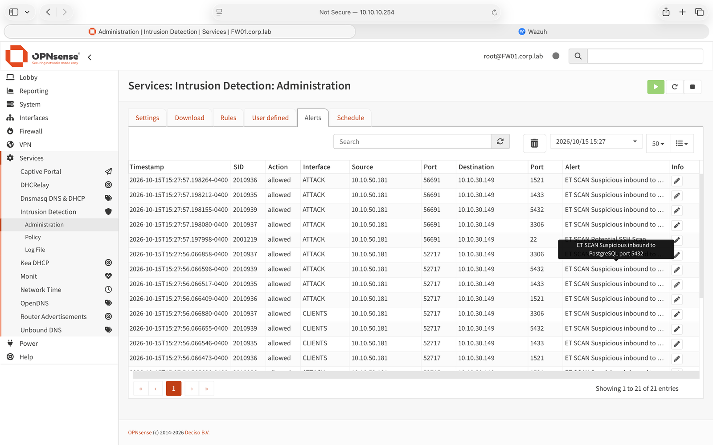

*OPNsense Intrusion Detection alerts: 21 ET SCAN entries from Kali (10.10.50.181) to WS01.*

### Gap: no decoder for the syslog line

`tcpdump` on the Wazuh host showed the Suricata lines arriving (program `suricata`, JSON body, `event_type` alert). `wazuh-logtest` pre-decoded them but reported "No decoder matched", and the event fell to rule 1002 (level 2, "Unknown problem somewhere in the system").

### Fix: decoder and rules 100300, 100301

```xml
<decoder name="suricata-eve">
  <program_name>^suricata</program_name>
</decoder>

<decoder name="suricata-eve-json">
  <parent>suricata-eve</parent>
  <prematch>^\s*{\s*"</prematch>
  <plugin_decoder>JSON_Decoder</plugin_decoder>
</decoder>

<group name="local,suricata,ids,">
  <rule id="100300" level="3">
    <decoded_as>suricata-eve</decoded_as>
    <field name="event_type">^alert$</field>
    <description>Suricata: $(alert.signature)</description>
  </rule>
  <rule id="100301" level="7">
    <if_sid>100300</if_sid>
    <field name="alert.signature" type="pcre2">^ET SCAN</field>
    <description>Suricata: network scan detected ($(alert.signature)) from $(src_ip) to $(dest_ip)</description>
    <mitre>
      <id>T1046</id>
    </mitre>
  </rule>
</group>
```

### Result

After restarting the manager and rerunning the scan, Threat Hunting showed 16 hits for rule 100301 between 15:40:51 and 15:40:53 (level 7, agent `wazuh`). Descriptions read, for example, "Suricata: network scan detected (ET SCAN Suspicious inbound to MSSQL port 1433) from 10.10.50.181 to 10.10.30.149". The reporting agent is the manager, because the log arrives by syslog.

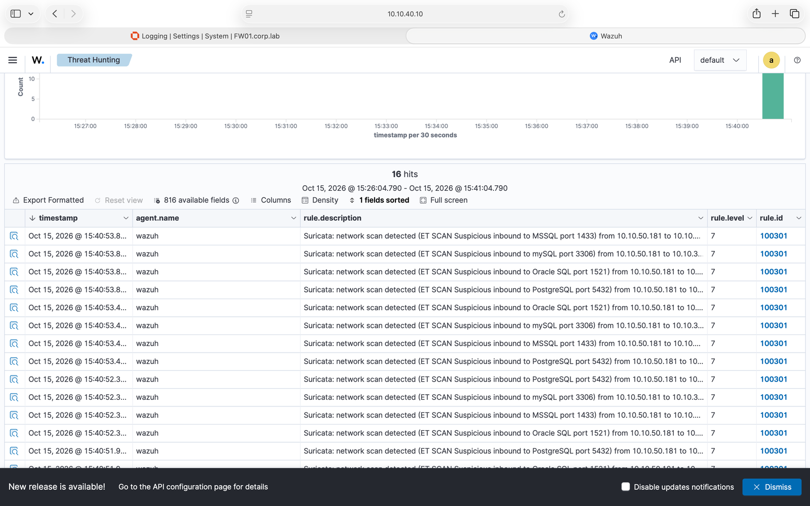

*Wazuh Events: 16 alerts from custom rule 100301 at level 7.*

### Limitations

- Each probe alerts twice, once per monitored interface. A dedup rule or a single capture interface would halve the volume.
- The ET SCAN port rules fire on a single SYN, so a stray connection to port 3306 also alerts.
- IDS mode only reports; Suricata does not block anything.

## Account creation on DC01

BadBlood populated the corp.lab domain with test objects (`-UserCount 500 -GroupCount 60 -ComputerCount 40 -SkipLapsInstall`). Counts afterwards: 495 users, 110 groups, 41 computers, including built-in objects.

### Baseline: default rule 60109

Wazuh already alerts on every account creation. The query `data.win.system.eventID: 4720` over the last hour returned 211 hits from DC01, all rule 60109 (level 8, "User account enabled or created"). No custom rule is needed for single creations.

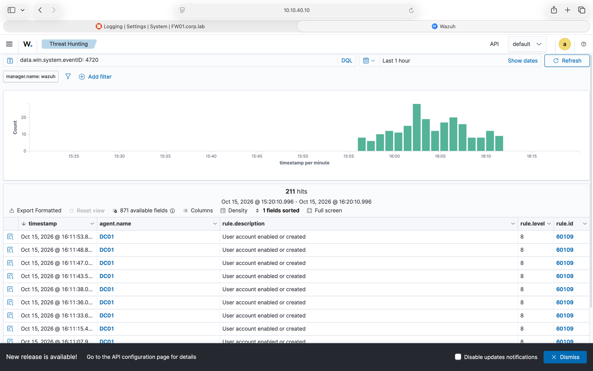

*Baseline: 211 event 4720 hits on DC01 in one hour, all rule 60109 at level 8.*

### Gap: no burst detection

Each alert stands alone, so a script that creates dozens of accounts in a minute looks the same as an admin making one. A mass creation is a common persistence and staging pattern.

### Fix: rule 100400

```xml
<group name="local,windows,ad,">
  <rule id="100400" level="10" frequency="10" timeframe="60">
    <if_matched_sid>60109</if_matched_sid>
    <same_field>win.system.eventID</same_field>
    <description>Mass account creation detected: 10+ accounts created within 60 seconds</description>
    <mitre>
      <id>T1136.002</id>
    </mitre>
  </rule>
</group>
```

### Result

On DC01, 15 disabled test accounts (`zz.test1` to `zz.test15`) were created in a loop with `New-ADUser`. The query `rule.id: 100400` returned 1 hit at 16:22:51 from agent DC01, level 10, "Mass account creation detected: 10+ accounts created within 60 seconds". The test accounts were deleted afterwards. After the rule was changed to require the same event ID (see below), the same test fired it again at 17:18:30.

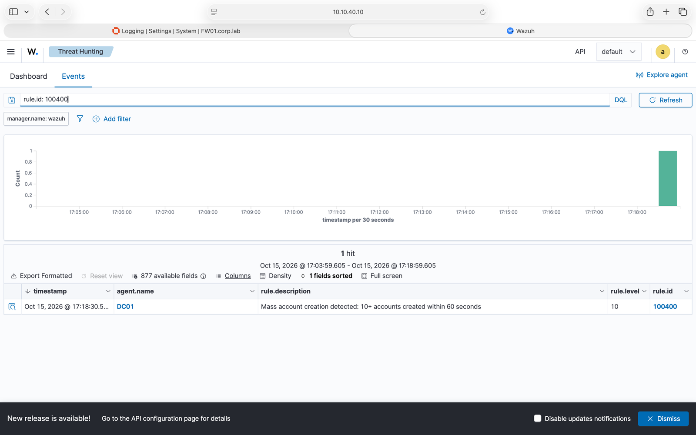

*Rule 100400 after the same_field change: one level 10 alert on DC01 at 17:18:30.*

### Boundary test

To find the real threshold I created disabled accounts on DC01 in three batches, 150 seconds apart so the 60 second windows did not overlap: 9 accounts at 22:29:24, 10 at 22:31:54 and 11 at 22:34:25.

The query `rule.id: 100400` over the last hour returned two level 10 alerts on DC01, at 22:31:55 and 22:34:26. The batch of 9 raised none.

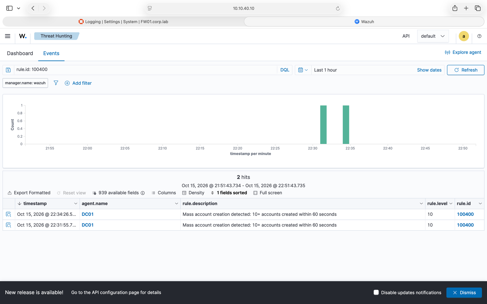

Two alerts, one for the batch of 10 and one for the batch of 11.

The query `rule.id: 60109` returned 28 hits. The three batches created 30 accounts, and 28 plus the two 100400 alerts makes 30. That fits the event that reaches the threshold being reported as 100400 instead of as 60109, but I did not open the individual alerts to check which event carried it.

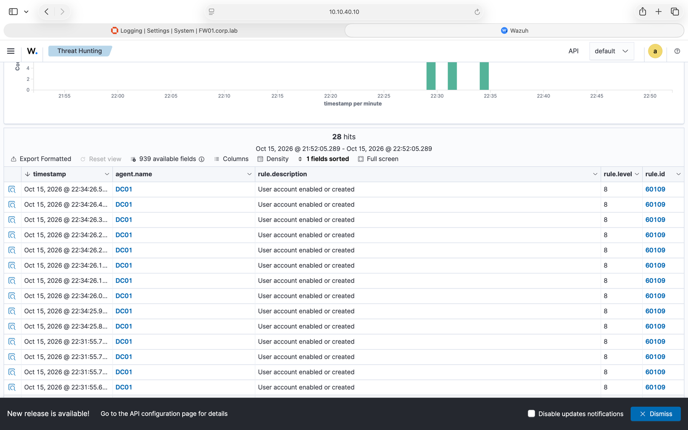

28 alerts from rule 60109 across the three batches.

So the rule fires at 10 accounts within 60 seconds, not at 9, and the batch of 11 produced a single alert. I removed the test accounts afterwards, and a count of the `zz.*` accounts returned 0.

### Limitations

- The rule counts alerts together, not per creating user, so two admins working at once could trip it. It requires the same event ID, so the 4722 events that follow each enabled account should no longer add to the count (not tested separately).
- Legitimate bulk provisioning, such as onboarding a class, will alert too. An exception for a known provisioning account would reduce that.

## T1053.005 Scheduled Task

Atomic test 1 creates two scheduled tasks on WS01, named `T1053_005_OnLogon` and `T1053_005_OnStartup`, and the cleanup step deletes them with `schtasks /delete`.

### Baseline: default rules

The query `rule.mitre.id: T1053.005` returned 38 hits, but nearly all were rule 92154 (level 4, "Process loaded taskschd.dll module") on both DC01 and WS01 across the whole hour. That is background noise, not the test. The query `data.win.system.eventID: 1 AND data.win.eventdata.image: *schtasks.exe AND agent.name: WS01` returned 7 hits, all rule 92032 (level 3, "Suspicious Windows cmd shell execution"). The event inspected was the cleanup command `schtasks /delete /tn "T1053_005_OnStartup" /f` with parent `cmd.exe`, run by the admin account at High integrity.

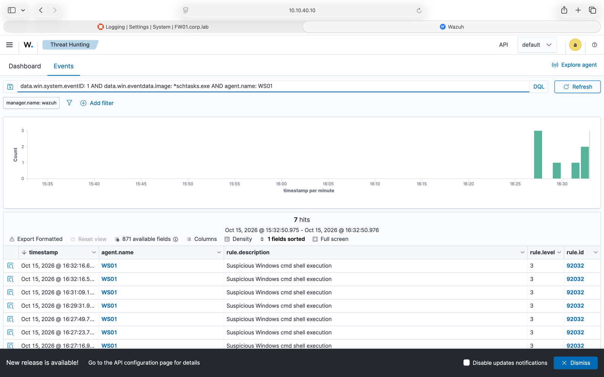

*Baseline: schtasks.exe process events on WS01 raised only the generic rule 92032 at level 3.*

### Gap: no rule for task creation

The only default match is a generic cmd shell rule at level 3. Nothing names a scheduled task or carries the T1053.005 mapping for `schtasks /create`.

### Fix: rule 100500

```xml
<group name="local,sysmon,windows,">
  <rule id="100500" level="8">
    <if_group>sysmon_event1</if_group>
    <field name="win.eventdata.image" type="pcre2">(?i)\\schtasks\.exe$</field>
    <field name="win.eventdata.commandLine" type="pcre2">(?i)\s[-/]create(\s|$)</field>
    <description>Sysmon: scheduled task created via schtasks.exe (Persistence)</description>
    <mitre>
      <id>T1053.005</id>
    </mitre>
  </rule>
</group>
```

The rule matches `/create` or `-create`, so the cleanup `/delete` commands do not alert.

### Result

After restarting the manager and rerunning the test, the query `rule.id: 100500` returned 2 hits from WS01, at 16:36:17 and 16:36:24, one per created task, level 8, "Sysmon: scheduled task created via schtasks.exe (Persistence)".

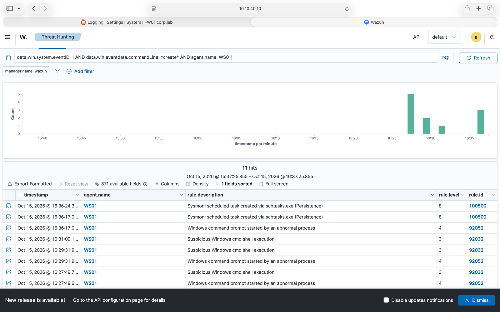

*Rule 100500 at level 8 next to the generic default alerts for the same commands.*

### Limitations

- The rule alerts once per schtasks.exe create command, so the two test tasks gave two alerts seven seconds apart. A burst of task creation will produce a burst of alerts.
- Any admin running `schtasks /create` alerts, including legitimate maintenance. Excluding known task names or parent processes would cut that.
- Tasks created through the Task Scheduler API or PowerShell cmdlets do not use `schtasks.exe` and would not match.

## T1547.001 Registry Run Keys

The test sets a value named "Atomic Red Team" under the current user's `Run` key on WS01 with `reg.exe`, pointing at `C:\Path\AtomicRedTeam.exe`. Anything in that key starts at the next logon.

### Result: covered by default rules

Wazuh alerted on the Sysmon event without any custom rule. The query `data.win.system.eventID: 13 AND agent.name: WS01` returned one hit, rule 92302 (level 6, "Registry entry to be executed on next logon was modified using command line application reg.exe"), in the groups `sysmon` and `sysmon_eid13_detections`. The alert maps to T1547.001 (tactics Persistence and Privilege Escalation).

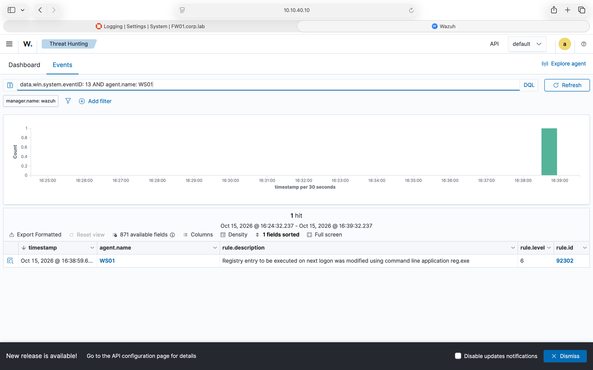

*Sysmon event 13 on WS01 matched by default rule 92302 at level 6.*

| Field | Value |
| --- | --- |
| `data.win.system.eventID` | 13 (SetValue) |
| `data.win.eventdata.image` | `C:\WINDOWS\system32\reg.exe` |
| `data.win.eventdata.targetObject` | `HKU\...\Software\Microsoft\Windows\CurrentVersion\Run\Atomic Red Team` |
| `data.win.eventdata.details` | `C:\Path\AtomicRedTeam.exe` |
| `data.win.eventdata.user` | `CORP\adm.truong` |
| `rule.id` / `rule.level` | 92302 / 6 |
| `rule.mitre.id` | T1547.001 |

The Sysmon event is stamped 20:38:28 UTC (16:38 Eastern) and the alert 16:38:59, so latency was about 30 seconds.

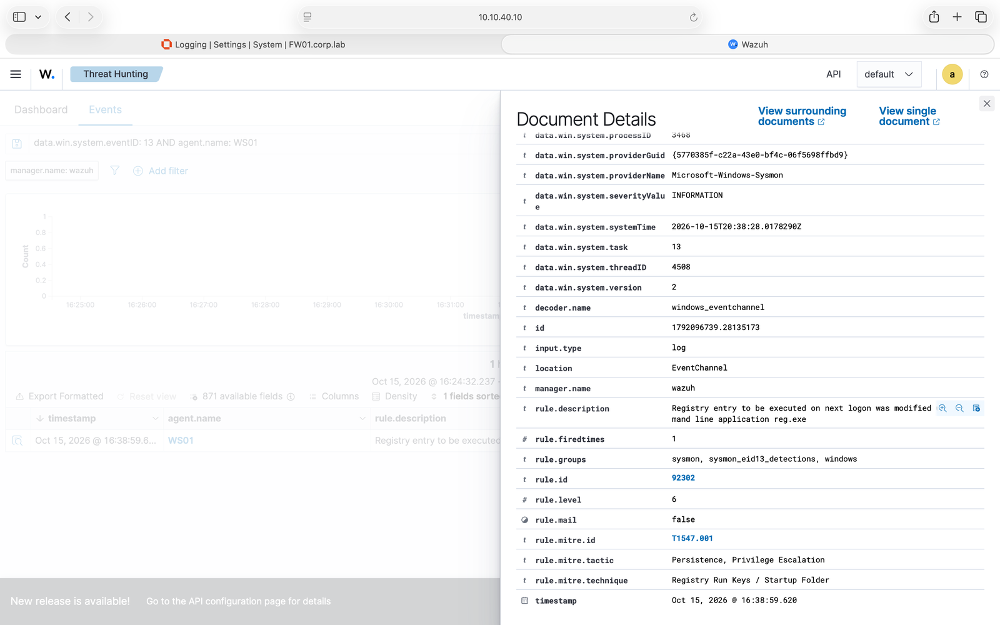

*Alert details: rule.mitre.id T1547.001, tactics Persistence and Privilege Escalation.*

### Limitations

- The rule is tied to command line tools such as `reg.exe`. A Run key written through PowerShell or the registry API may be matched by other rules or not at all, and was not tested here.
- Level 6 is below the level where most teams page anyone. Raising it for writes pointing at user-writable paths such as Temp or AppData would make it stand out.

## T1136.001 Local Account Creation

Atomic test 4 runs `net user /add "T1136.001_CMD" ...` on WS01. The built-in password failed the domain password policy (`NET HELPMSG 2245`), so the test was run again with a compliant password passed through `-InputArgs`. The account was deleted afterwards with the test's cleanup step, confirmed with `net user`.

### Baseline: default rule 60109

Wazuh already alerted on the account creation. Rule 60109 (level 8, "User account enabled or created", groups `adduser` and `account_changed`) fired on Security event 4720 from WS01. The event shows target account `T1136.001_CMD`, target domain `WS01` (the machine name, which marks it as local), created by `CORP\adm.truong`.

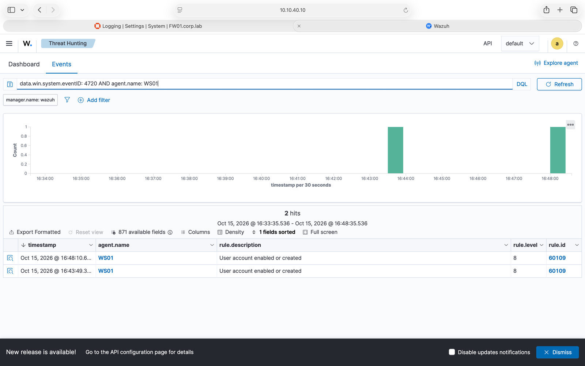

*Baseline: two event 4720 alerts on WS01 from the default rule 60109.*

### Gap: wrong technique, double events

Rule 60109 maps to T1098 Account Manipulation, not T1136.001 Create Account: Local Account, so a hunt on `rule.mitre.id: T1136.001` would miss it. Windows also logs event 4722 ("A user account was enabled") right after 4720, and 60109 matches both, which gives two alerts for one creation.

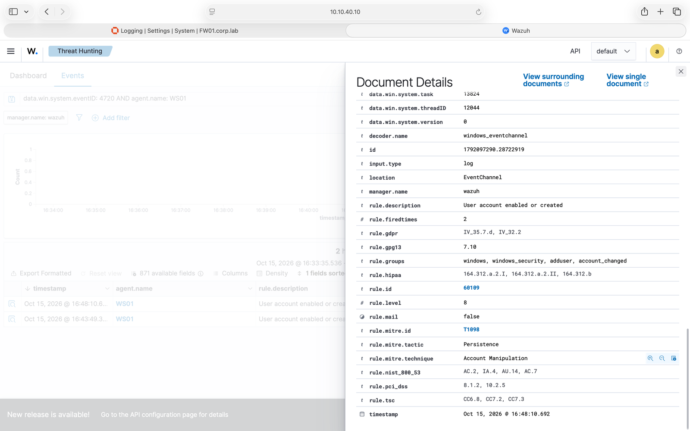

*The default alert carries T1098 Account Manipulation, not T1136.001.*

### Fix: rule 100450

```xml
<group name="local,windows,ad,">
  <rule id="100450" level="8">
    <if_sid>60109</if_sid>
    <field name="win.system.eventID">^4720$</field>
    <field name="win.eventdata.targetDomainName" type="pcre2">^(?!CORP$).+</field>
    <description>Local user account created on a workstation ($(win.eventdata.targetUserName))</description>
    <mitre>
      <id>T1136.001</id>
    </mitre>
  </rule>
</group>
```

The first version had no event ID check and also matched 4722, which has no `samAccountName`, so one alert showed an empty name in its description. Limiting the rule to 4720 and reading `targetUserName` fixed that.

### Result

The query `rule.id: 100450` returned 2 hits from WS01 at 17:11:48 and 17:13:58, both level 8, "Local user account created on a workstation (T1136.001_CMD)", with none from event 4722. The rule carries T1136.001 (tactic Persistence).

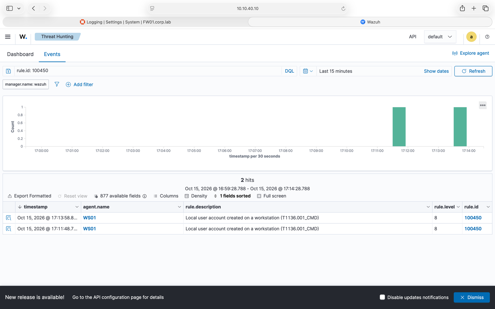

*Rule 100450 alerts for T1136.001_CMD at 17:11:48 and 17:13:58, level 8.*

### Limitations

- The domain check compares against `CORP`, so it is tied to this lab's NetBIOS name.
- Any local account creation on any monitored machine alerts, including legitimate ones such as imaging or helpdesk work.
- Rule 100400 (mass account creation) first counted 4722 events too and would trip at about half its stated threshold for accounts created enabled. It now requires the same event ID, and still fired on the 15 account test at 17:18:30.

## T1070.001 Clear Windows Event Logs

The Atomic Red Team definition file for T1070.001 is missing from the atomics folder, so the test was the equivalent command run by hand on WS01 from PowerShell as `CORP\adm.truong`: `wevtutil cl Application`.

### Baseline: partial coverage

Default rule 63104 ("A Windows log file was cleared", level 5) fired on WS01 at 17:23:30 from event 104. The query `rule.mitre.id: T1070.001` returned no results. The stock rule maps to the parent technique T1070 only, which I confirmed in the rule definition (the same in the 4.14.8 package), so the alert had no sub-technique. A Sysmon query for the `wevtutil.exe` process also returned no alert, although `Get-WinEvent` showed Sysmon had logged event 1 with the full command line.

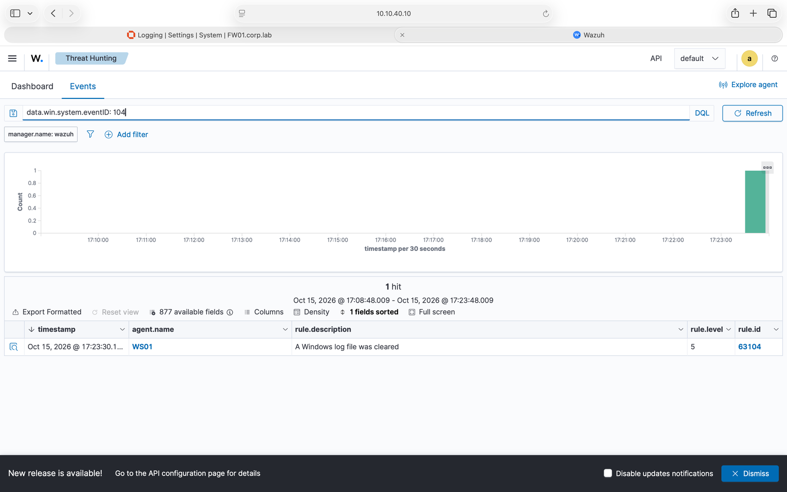

*Baseline: event 104 on WS01 matched by default rule 63104 at level 5, 17:23:30.*

### Gap: no sub-technique and no process alert

The log clearing was noticed only after the fact and at a low level. The command that caused it was never alerted. Sysmon labelled the event `technique_id=T1685.005`. The ATT&CK site now lists Clear Windows Event Logs under [T1685.005](https://attack.mitre.org/techniques/T1685/005), so T1070.001 appears to be the older ID. Both rules below use T1070.001, the ID the default Wazuh rules and common detection write-ups still use.

### Fix: two custom rules

```xml
<group name="local,windows,defense_evasion,">
  <rule id="100550" level="8">
    <if_group>sysmon_event1</if_group>
    <field name="win.eventdata.image" type="pcre2">(?i)\\wevtutil\.exe$</field>
    <field name="win.eventdata.commandLine" type="pcre2">(?i)\s(cl|clear-log)\s</field>
    <description>Sysmon: wevtutil used to clear an event log</description>
    <mitre>
      <id>T1070.001</id>
    </mitre>
  </rule>

  <rule id="100551" level="8">
    <if_sid>63103, 63104</if_sid>
    <description>Windows event log cleared (possible defense evasion)</description>
    <mitre>
      <id>T1070.001</id>
    </mitre>
  </rule>
</group>
```

### Result

After restarting the manager and rerunning `wevtutil cl Application`, the query `rule.id: 100550 or rule.id: 100551` returned 2 hits from WS01, both level 8: rule 100551 "Windows event log cleared (possible defense evasion)" at 17:27:30 and rule 100550 "Sysmon: wevtutil used to clear an event log" at 17:27:31. The 100550 alert details show rule.mitre.id T1070.001, tactic Defense Evasion and technique Clear Windows Event Logs, with parent process powershell.exe run by CORP\adm.truong.

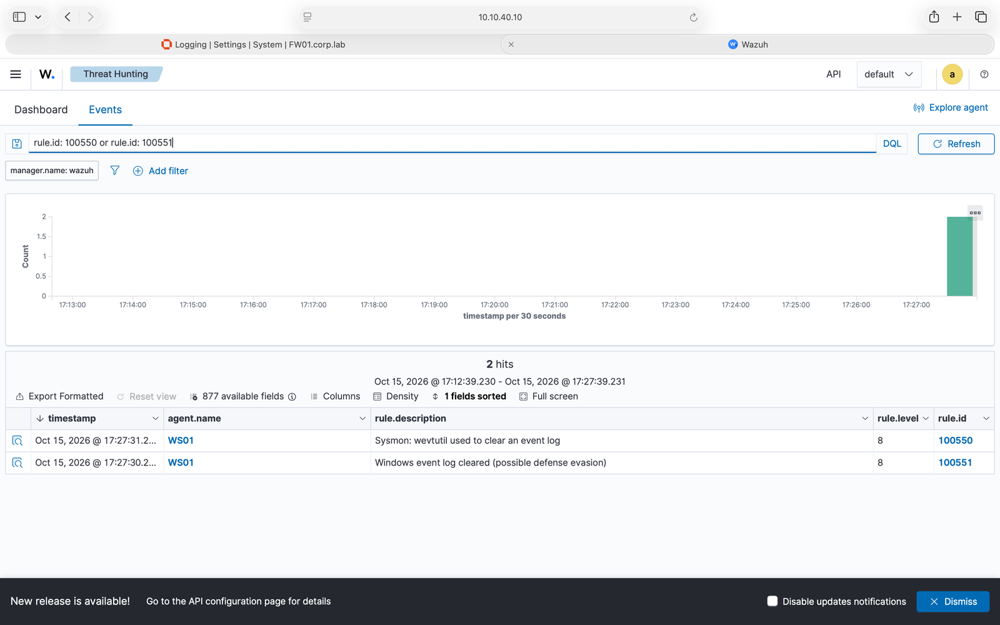

*Both custom rules fired on WS01 at level 8, one second apart.*

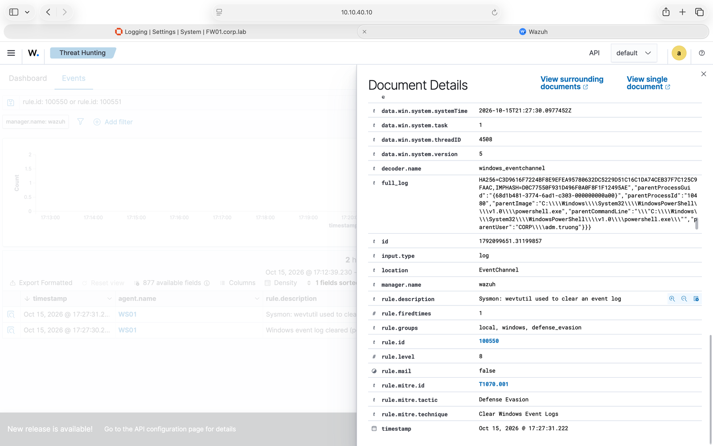

*Alert details for rule 100550: T1070.001, tactic Defense Evasion, technique Clear Windows Event Logs.*

### Limitations

- Only `wevtutil.exe` is covered. Clearing logs with PowerShell `Clear-EventLog` or `Remove-EventLog` would trigger 100551 through event 104 but not 100550.
- The rule matches `cl` or `clear-log` as a separate word; only `cl` was tested.
- Wazuh accepts T1070.001 in this version, but the alerts do not carry the newer T1685.005 ID, so a dashboard filtered on it will miss them.

## T1110 Brute Force over SMB

The test was 12 failed SMB logons from Kali (10.10.50.181) to WS01 with `smbclient -L //10.10.30.149 -U 'fakeuser%WrongPass123'`. The account does not exist, so every attempt is a failure. No Atomic test was used.

### Setup note: the first attempt never reached the logon stage

The first 12 attempts all timed out. The OPNsense log for the connection showed `match,pass,out`, so the firewall passed the traffic and WS01 dropped it, most likely at Windows Defender Firewall. This also means rule 100200 never fired for it, because that rule only matches blocked packets. To run the test, SMB was opened on WS01 for Kali's IP only with a temporary firewall rule, then the rule was removed.

### Result: coverage by default rules

The query `data.win.system.eventID: 4625` returned 12 hits on WS01 between 18:15:32 and 18:15:51: 11 alerts from rule 60122 "Logon Failure - Unknown user or bad password" (level 5) and one from rule 60204 "Multiple Windows Logon Failures" (level 10) at 18:15:42. Rule 60122 carries `rule.mitre.id` T1531 (Account Access Removal), which is not the right technique for a password guess; I confirmed this in the [attack chain session](attack-chain-timeline.md). Rule 60204 has frequency 8, groups `authentication_failures`, and carries `rule.mitre.id` T1110 with tactic Credential Access and technique Brute Force.

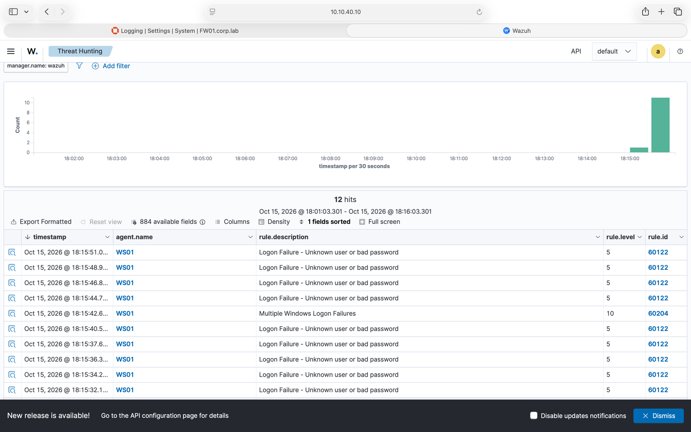

*Event 4625 alerts on WS01: eleven from rule 60122 and one from rule 60204.*

The underlying event shows the source IP 10.10.50.181, workstation name KALI, target user `fakeuser`, logon type 3 (network), NTLM, status `0xc000006d` and sub status `0xc0000064` (user name does not exist).

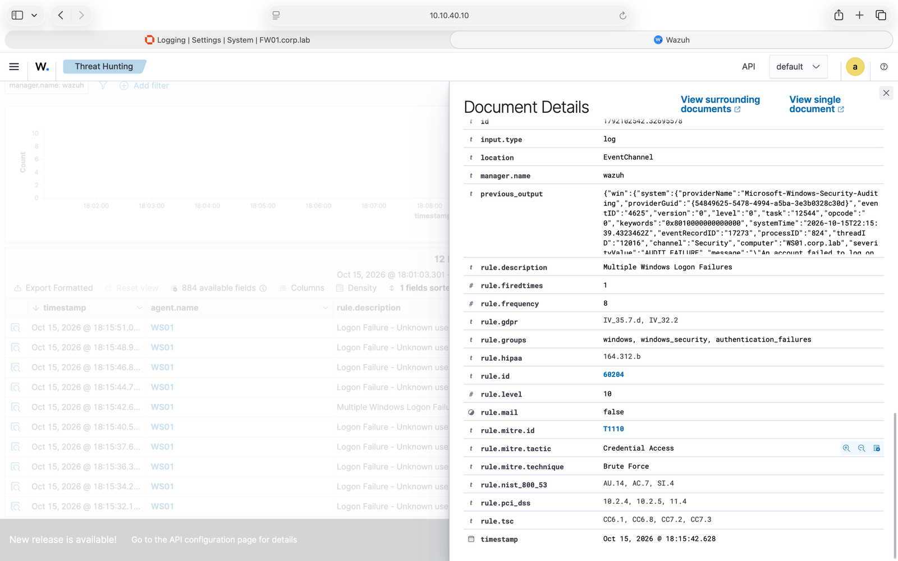

*Alert details for rule 60204: T1110, tactic Credential Access, technique Brute Force.*

### Limitations

- The alert is mapped to the parent technique T1110, not a sub-technique such as T1110.001 (password guessing) or T1110.003 (password spraying).
- The test used one non-existent account from one source. Spraying across many real accounts was not tested.
- Detection depends on WS01 receiving the traffic. With Windows Firewall dropping SMB, nothing is logged on the host and OPNsense only records a pass.

## T1059.001 PowerShell

The test was Atomic T1059.001-17, which runs `powershell.exe -e` with an obfuscated Base64 payload. I decoded the payload before running it: it rebuilds `iex` from string pieces and prints "Hello, from PowerShell!". Test 15 was skipped because it needs a module downloaded from the PowerShell Gallery.

### Result: coverage by default rules

The query `rule.mitre.id: T1059.001` returned one alert on WS01 at 18:30:03: rule 92057, "Powershell.exe spawned a powershell process which executed a base64 encoded command", level 12. That is a high level with the right technique, so no custom rule was needed.

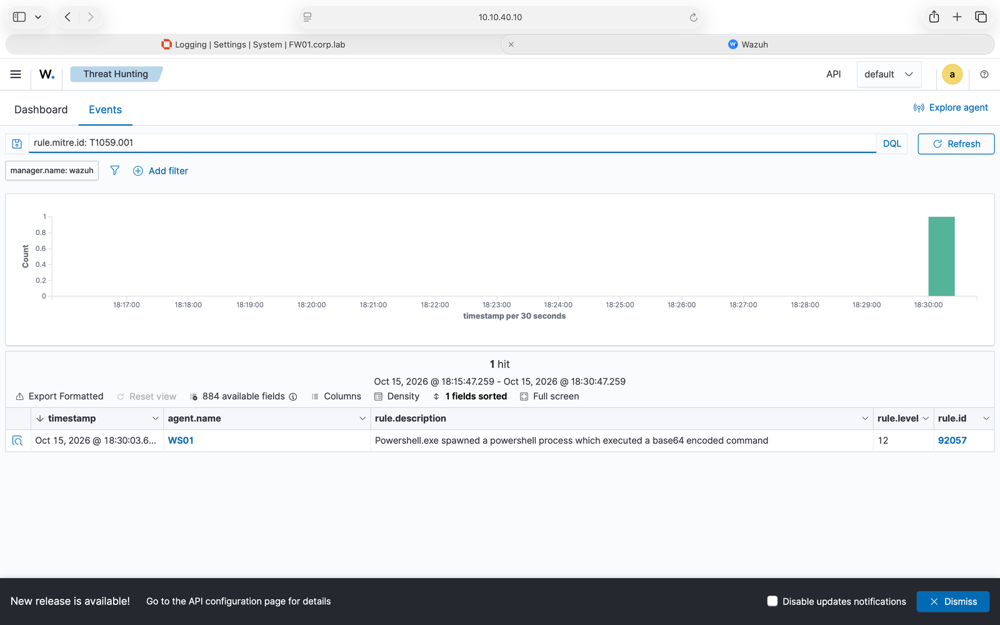

*Rule 92057 at level 12 on WS01, matched by the T1059.001 technique query.*

The command line also raised two generic alerts from rule 67027 "A process was created" at level 3 at 18:29:57, found by searching for the start of the encoded payload.

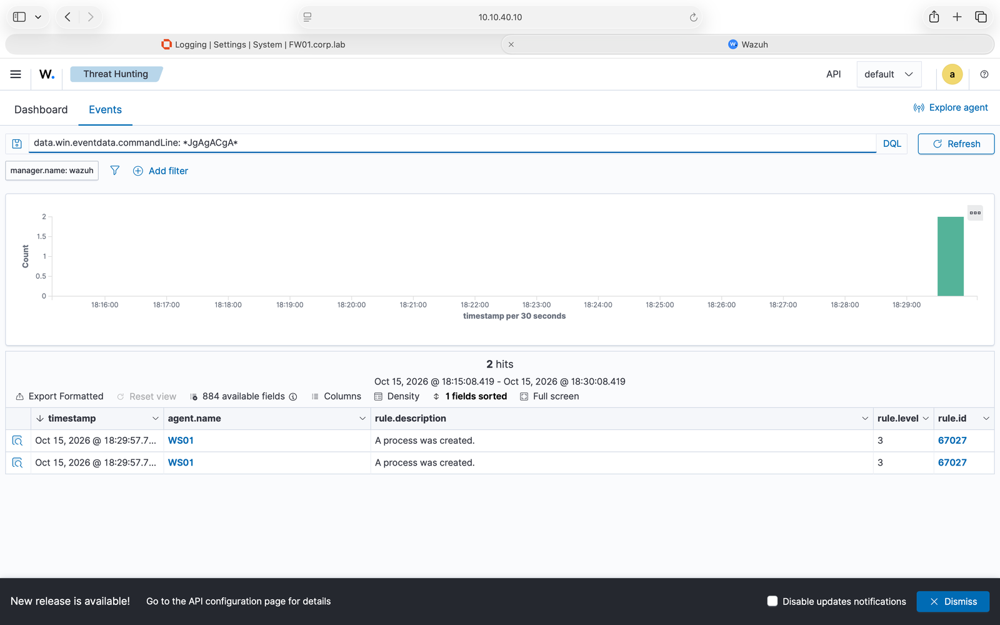

*Two level 3 alerts from rule 67027 carry the encoded command.*

### Limitations

- Only one encoded command was tested. Other forms, such as `-EncodedCommand`, `-enc` or download cradles, were not.
- The query for the script block text in event 4104 returned no alert. Wazuh shows only events that a rule alerts on, so this does not show whether Windows logged the event.

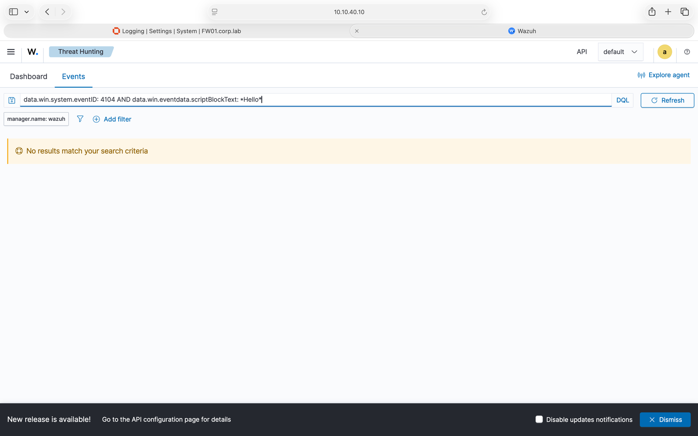

*The 4104 script block query returned no results.*

## T1087.001 Account Discovery

The Atomic tests for T1087.001 run `net.exe`, `cmdkey.exe` and `query.exe` on WS01 to list local users, groups, stored credentials and logged on users.

### Result: coverage by default rules

The query `rule.mitre.id: T1087.001` returned no results. The commands were still logged by Sysmon event 1 and raised generic alerts at level 3: five hits for `net.exe` (rule 92033 twice, rule 92036 three times) and two hits for `cmdkey.exe` and `query.exe` (rule 92032).

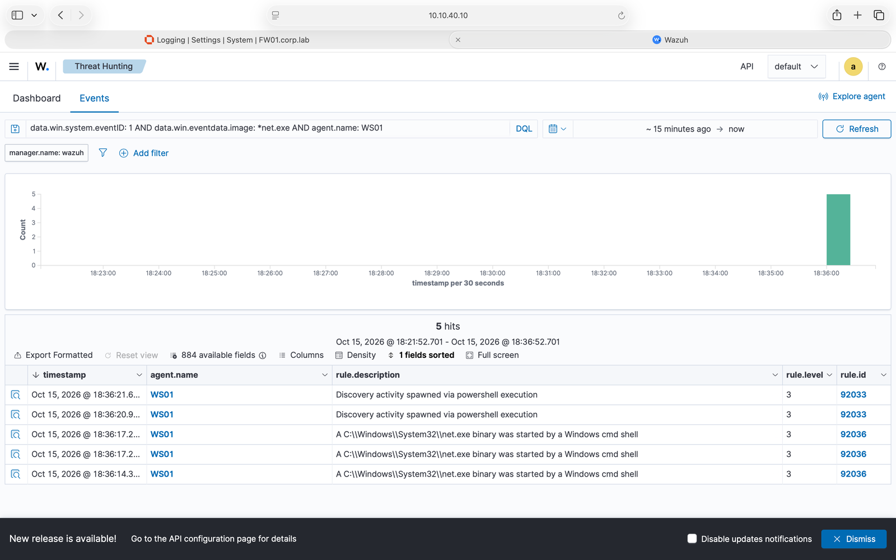

*Five level 3 alerts for net.exe from rules 92033 and 92036.*

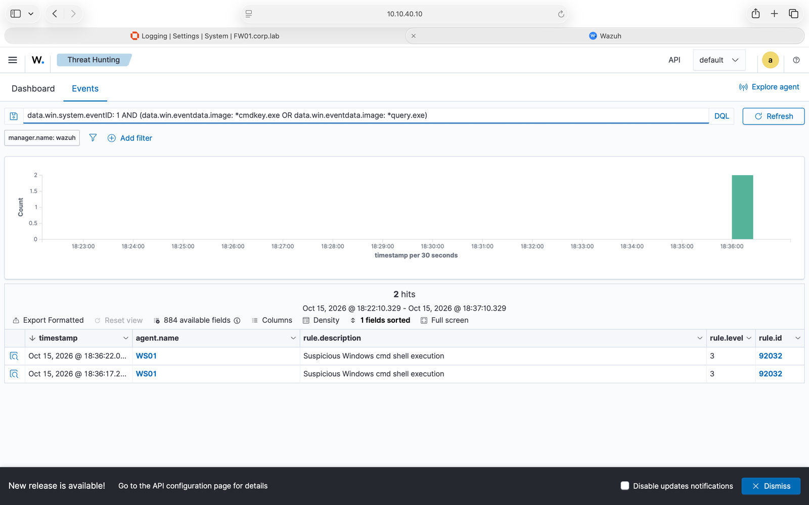

*Two level 3 alerts from rule 92032 for cmdkey.exe and query.exe.*

### Custom rules

Rules 100600 to 100603 match the image and command line of Sysmon event 1. 100600 covers `net user` and `net accounts` (T1087.001), 100601 covers `net localgroup` and `net group` (T1069.001), 100602 covers `cmdkey /list` (T1555.004) and 100603 covers `query user` and `quser` (T1033). Each is level 6, and the net.exe rules skip `/add` and `/delete` so they do not overlap the account creation rules.

```xml
<group name="local,windows,discovery,">
  <rule id="100600" level="6">
    <if_group>sysmon_event1</if_group>
    <field name="win.eventdata.image" type="pcre2">(?i)\\net1?\.exe$</field>
    <field name="win.eventdata.commandLine" type="pcre2">(?i)\bnet1?(\.exe)?[\\"]*\s+(?!.*\s/(add|delete)(\s|$))(user|users|accounts)(\s|$)</field>
    <description>Sysmon: local account enumeration with net.exe</description>
    <mitre><id>T1087.001</id></mitre>
  </rule>

  <rule id="100601" level="6">
    <if_group>sysmon_event1</if_group>
    <field name="win.eventdata.image" type="pcre2">(?i)\\net1?\.exe$</field>
    <field name="win.eventdata.commandLine" type="pcre2">(?i)\bnet1?(\.exe)?[\\"]*\s+(?!.*\s/(add|delete)(\s|$))(localgroup|group)(\s|$)</field>
    <description>Sysmon: local group enumeration with net.exe</description>
    <mitre><id>T1069.001</id></mitre>
  </rule>

  <rule id="100602" level="6">
    <if_group>sysmon_event1</if_group>
    <field name="win.eventdata.image" type="pcre2">(?i)\\cmdkey\.exe$</field>
    <field name="win.eventdata.commandLine" type="pcre2">(?i)\s/list</field>
    <description>Sysmon: stored credentials listed with cmdkey.exe</description>
    <mitre><id>T1555.004</id></mitre>
  </rule>

  <rule id="100603" level="6">
    <if_group>sysmon_event1</if_group>
    <field name="win.eventdata.image" type="pcre2">(?i)\\(query|quser)\.exe$</field>
    <field name="win.eventdata.commandLine" type="pcre2">(?i)(\suser(\s|$)|quser)</field>
    <description>Sysmon: logged on users enumerated</description>
    <mitre><id>T1033</id></mitre>
  </rule>
</group>
```

### Result: after the custom rules

Rerunning the tests produced 14 hits from rules 100600 to 100603, all level 6 on WS01, between 18:40:10 and 18:40:16.

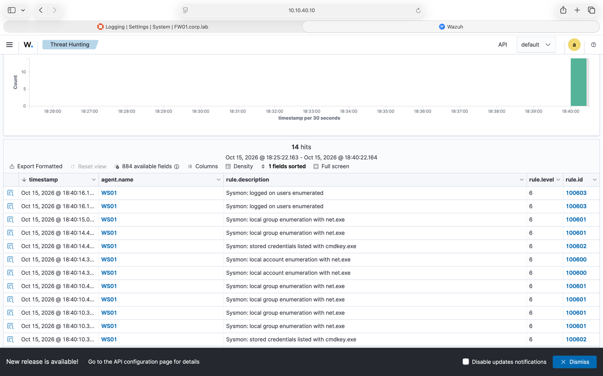

*Fourteen level 6 alerts from the four custom rules.*

The alert details confirm the technique fields. Rule 100600 fired on `net1 user` (the child process of `net.exe user`) and carries `rule.mitre.id` T1087.001, tactic Discovery, technique Local Account. Rule 100603 fired on `quser.exe` and carries T1033, tactic Discovery, technique System Owner/User Discovery.

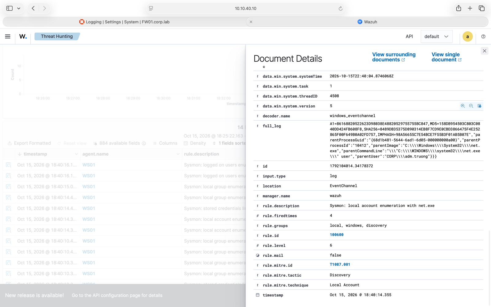

*Rule 100600 at level 6 with T1087.001, Discovery, Local Account.*


*Rule 100603 at level 6 with T1033, Discovery, System Owner/User Discovery.*

Rule 100602 fired on `cmdkey.exe /list` and carries T1555.004, tactic Credential Access, technique Windows Credential Manager.

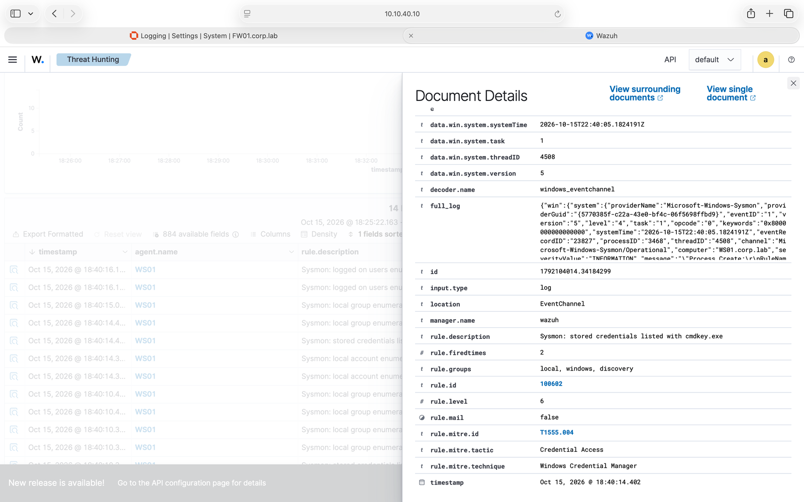

*Rule 100602 at level 6 with T1555.004, Credential Access, Windows Credential Manager.*

Rule 100601 fired on a `net.exe` group command and carries T1069.001, tactic Discovery, technique Local Groups.

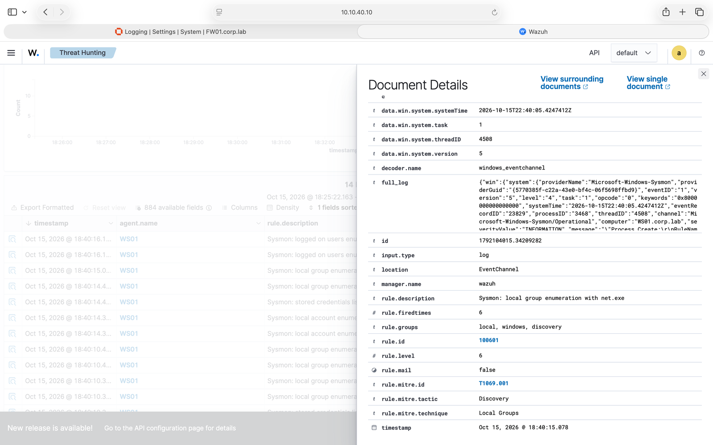

*Rule 100601 at level 6 with T1069.001, Discovery, Local Groups.*

### Review fixes: rule order and escaped quotes

A review of the rule file found that the first pattern of rule 100600 matched the word `users` anywhere in a net command line. Wazuh lets only the first matching rule among siblings alert, and 100600 sits before 100601. So `net localgroup users` alerted as 100600 (T1087.001) and rule 100601 (T1069.001) never fired for it.

I ran `net localgroup users` on its own, and later together with `net user`. The query `rule.id: (100600 or 100601)` over the last hour returned six hits, all from rule 100600 and none from 100601: two at 21:31:37 for the single command and four at 21:32:57 for the pair.

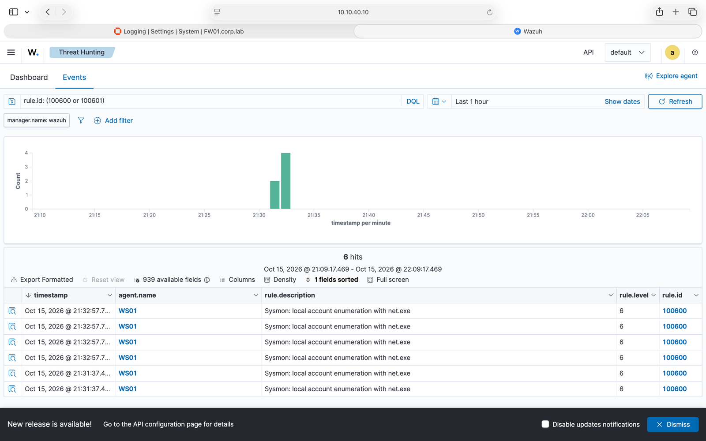

*Six hits, all rule 100600. Rule 100601 never fired.*

My first fix anchored the sub command right after the program name with `^"?` at the start of the pattern. After it, each command gave one alert instead of two, although Sysmon had logged four events for the two commands: `net.exe` and `net1.exe` for each. The `net.exe` command line starts with a quote and Wazuh holds the field with escaped quotes, the same trap as with the admin share rule, so the anchor most likely failed there and only the `net1.exe` events alerted. I did not open those alerts to check which image matched.

The final pattern drops the anchor, looks for `net` or `net1` as a whole word, accepts backslashes and quotes after the name, and then requires the sub command. With it, the same two commands gave four alerts again: two from rule 100600 for `net user` and two from rule 100601 for `net localgroup users`.

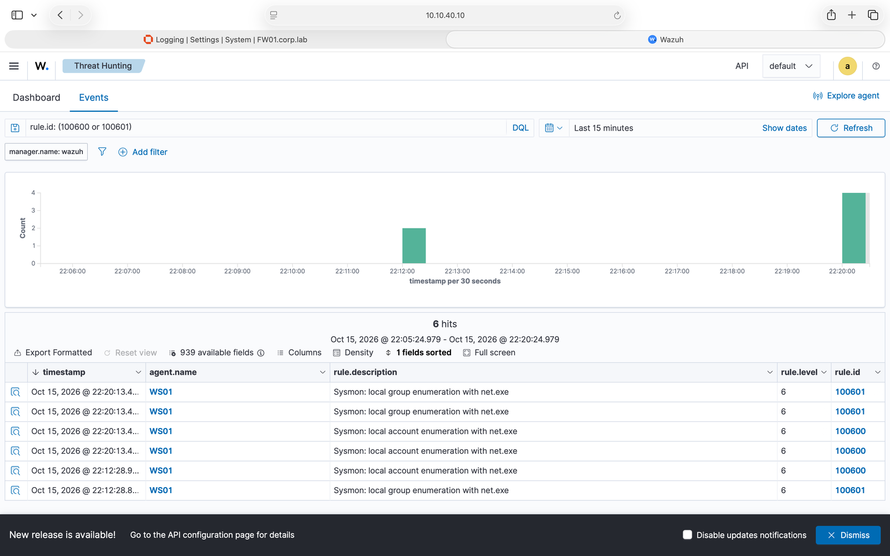

*After the final fix, two hits each from 100600 and 100601 at 22:20:13, next to the two single hits of the first fix at 22:12:28.*

### Limitations

- The technique fields were checked in the alert details for all four rules, one alert each.
- Only process based commands are matched. PowerShell cmdlets such as `Get-LocalUser` are not covered.
- Domain account discovery was not tested.
- Each net command still alerts twice, once for `net.exe` and once for the `net1.exe` process it starts.
- Rules 100600 and 100601 are siblings, so only the first match alerts. The patterns now require different sub commands, so the commands I tested do not match both.

## T1105 Ingress Tool Transfer

The test was Atomic T1105-7, which runs `certutil -urlcache -split -f` to download the public LICENSE.txt file from the Atomic Red Team GitHub repository. I ran it from PowerShell on WS01 as CORP\adm.truong.

### What Defender did

Atomic Red Team returned "Access is denied" when it tried to start the process. Windows Defender had blocked it: `Get-WinEvent` on WS01 showed event 1116 at 6:57:44 PM, threat `Trojan:Win32/Ceprolad.A`, severity Severe, with the full certutil command line as the detected path. Real-time protection, antivirus and behavior monitoring were all on.

### Result: coverage by default rules

The query `data.win.system.providerName: "Microsoft-Windows-Windows Defender"` returned no alerts for the last 15 minutes after the first run. Wazuh shows only events that a rule alerts on, so this alone did not say why. The cause is in the section on Defender detections below.

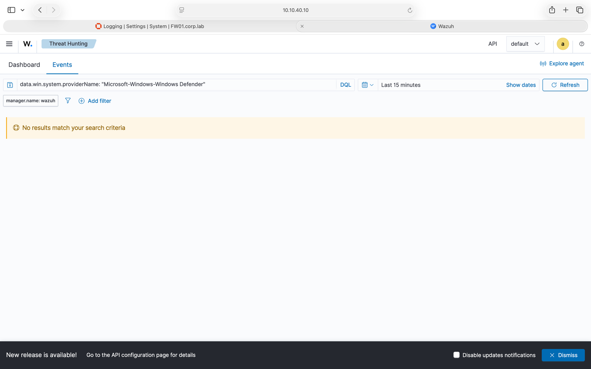

*No alerts from the Defender provider in the 15 minutes after the test.*

The command was still logged. Searching `data.win.eventdata.commandLine: *certutil*` found one Security event 4688 alert from rule 67027 "A process was created", level 3, showing `cmd.exe /c cmd /c certutil -urlcache -split -f` with the GitHub URL, parent `powershell.exe` and user `adm.truong`.

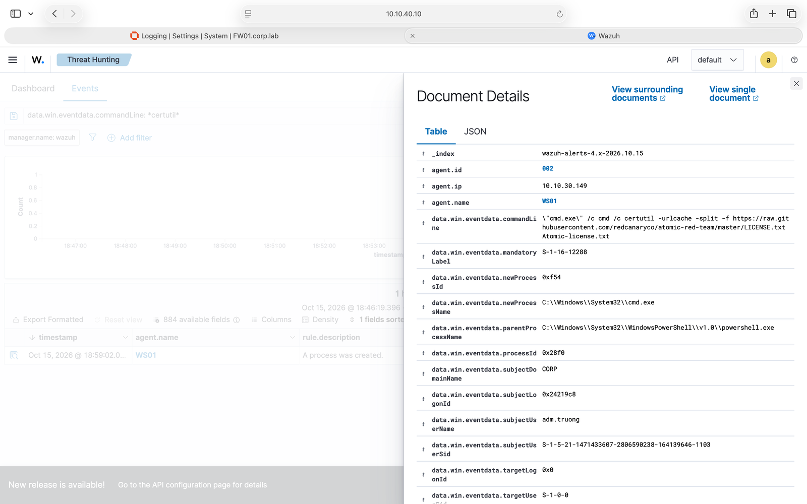

*Rule 67027 at level 3 carries the full certutil command line.*

The query `rule.mitre.id: T1105` returned one alert, but not this one. It was rule 92213 "Executable file dropped in folder commonly used by malware" at level 15, at 18:53:04, before the test. The alert details show Sysmon event 11: `powershell.exe` created a file named `__PSScriptPolicyTest_...ps1` in the user's Temp folder, which is a file PowerShell writes itself. This is noise from the default rule, unrelated to certutil.

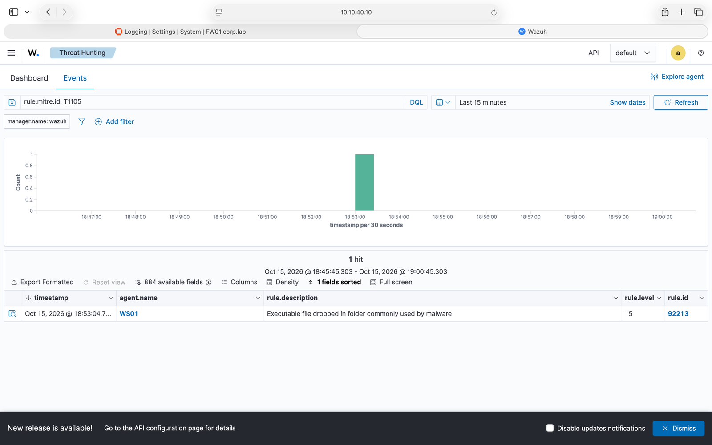

*The only T1105 alert before the custom rule is rule 92213 on a PowerShell temp file.*

### Custom rules

Rules 100700 and 100701 match a command line where `certutil` is followed by `-urlcache` or `-verifyctl` (with a dash or a slash). 100700 is a child of the Sysmon event 1 group and 100701 is a child of rule 67027 for Security event 4688. Both are level 8 and map to T1105.

```xml
<group name="local,windows,command_and_control,">
  <rule id="100700" level="8">
    <if_group>sysmon_event1</if_group>
    <field name="win.eventdata.commandLine" type="pcre2">(?i)certutil(\.exe)?\W+.*[-/](urlcache|verifyctl)(\s|$)</field>
    <description>Sysmon: certutil used to download a file</description>
    <mitre><id>T1105</id></mitre>
  </rule>
  <rule id="100701" level="8">
    <if_sid>67027</if_sid>
    <field name="win.eventdata.commandLine" type="pcre2">(?i)certutil(\.exe)?\W+.*[-/](urlcache|verifyctl)(\s|$)</field>
    <description>Security 4688: certutil used to download a file</description>
    <mitre><id>T1105</id></mitre>
  </rule>
</group>
```

### Result: after the custom rules

I added the rules and ran the test again. Defender blocked it the same way. The query `rule.id: (100700 or 100701)` returned one alert: rule 100701 "Security 4688: certutil used to download a file", level 8, on WS01 at 19:05:57.

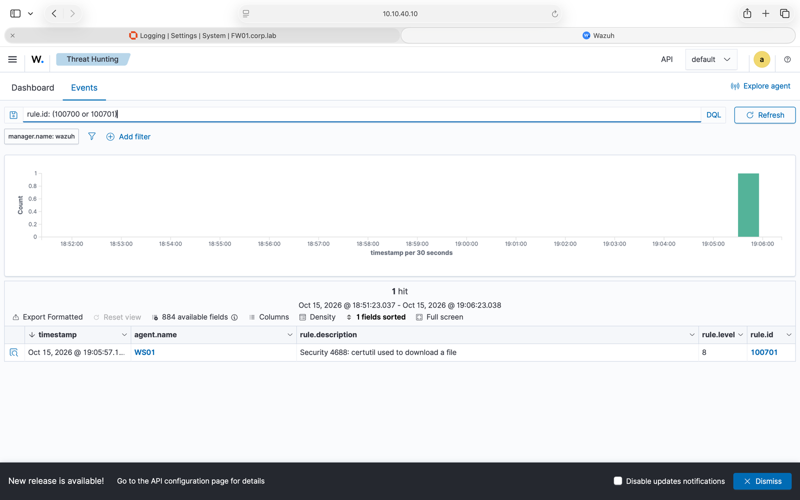

*Rule 100701 at level 8 on WS01.*

The alert details show the Security event 4688 with the certutil command line, `rule.mitre.id` T1105, tactic Command and Control, technique Ingress Tool Transfer. The event's own system time is 23:05:30 UTC (19:05:30 local) and Wazuh stamped the alert at 19:05:57.

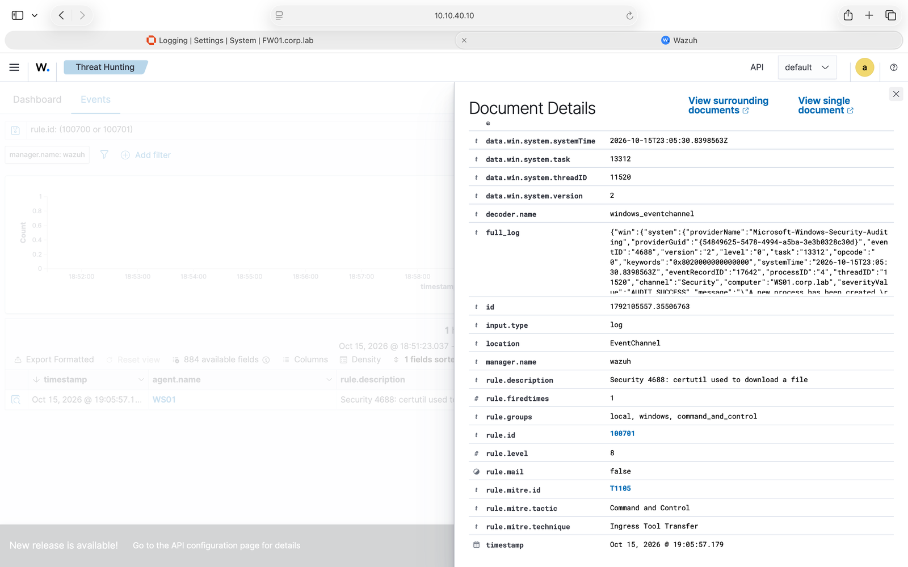

*Rule 100701 with T1105, Command and Control, Ingress Tool Transfer.*

### Defender detections in Wazuh

A search of `ossec.conf` on WS01 for "Defender" returned nothing, so the agent was not collecting the Defender channel. I added a `localfile` entry for `Microsoft-Windows-Windows Defender/Operational` with the `eventchannel` format and restarted the agent. The agent log then showed it analyzing that channel at 19:13:49.

After another run of the test, the Defender query returned two alerts on WS01: rule 62123 "Windows Defender: Antimalware platform detected potentially unwanted software" at level 12 at 19:14:54, and rule 62124 at level 3 at 19:15:35.

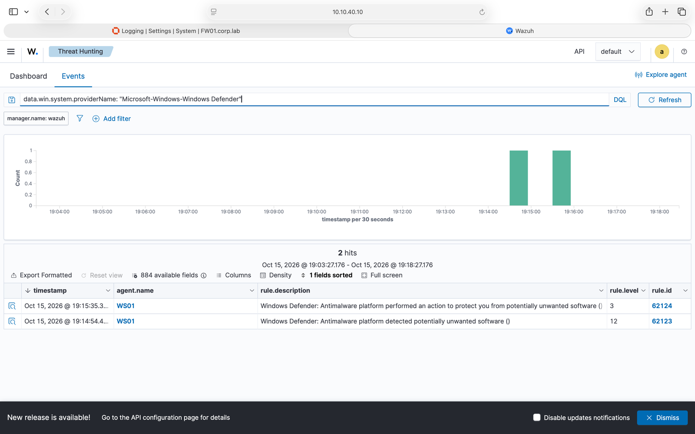

*Rules 62123 (level 12) and 62124 (level 3) after the agent started collecting the Defender channel.*

The alert details for rule 62123 show the groups `windows` and `windows_defender`, category Trojan, the blocked certutil command line in the `path` field, and the Microsoft link naming Trojan:Win32/Ceprolad.A. The event's own time is 23:14:26 UTC (19:14:26 local) and Wazuh stamped the alert at 19:14:54. The alert has no MITRE fields, and the description ends in empty parentheses where the threat name would go.

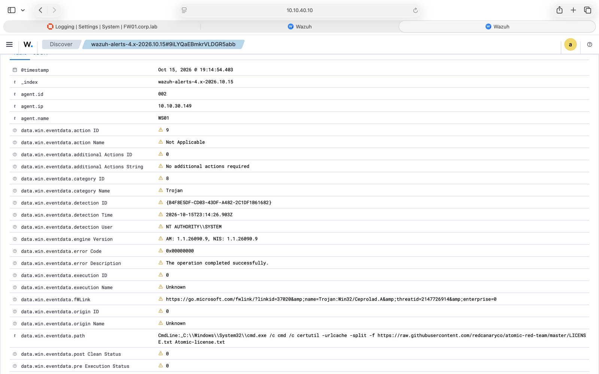

*Event data of the rule 62123 alert: category, detection time and the blocked command line.*

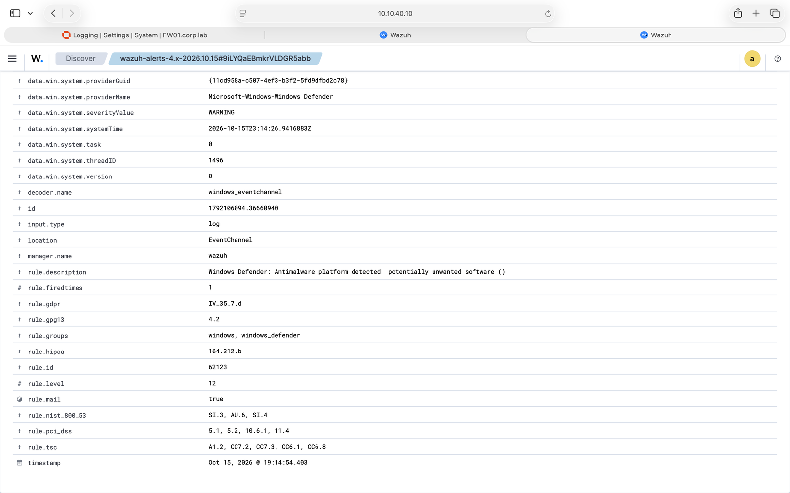

*Rule fields of the same alert: level 12, groups windows and windows_defender.*

So the default ruleset already covers Defender detections. The gap was the agent configuration, not the rules.

### Why rule 100700 stayed silent

In the real runs, rule 100700 never alerted. I checked each step on WS01. Security event 4688 recorded four certutil events at 18:57, 19:05, 19:14 and 19:17. All four were for `cmd.exe`, started by `powershell.exe`, with the certutil command in its command line. Sysmon event 1 held 394 events over the same 12 hours and none of them contained certutil.

Sysmon does record this kind of process. The harmless command `cmd.exe /c cmd /c echo certutil-probe-001` was logged by Sysmon twice at 20:03:05. I then ran the Atomic test once more. Defender blocked it again with "Access is denied", Sysmon event 1 had no certutil event, and rule 100701 alerted at 20:04:11.

To check that rule 100700 itself works, I ran `cmd.exe /c echo certutil -urlcache -split -f probe-002`. It only prints text, but its command line contains the words the rule looks for. Both rules alerted at 20:04:51.

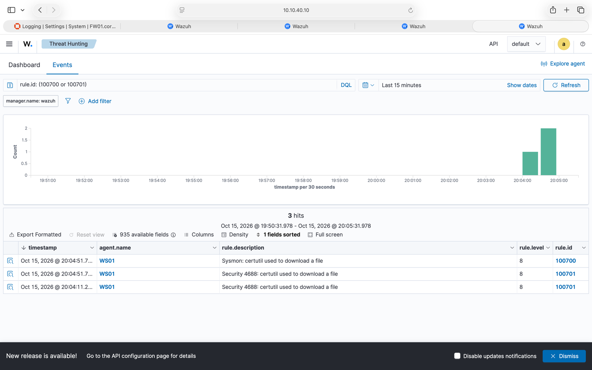

*Three hits: 100701 at 20:04:11 from the blocked test, then 100700 and 100701 at 20:04:51 from the echo probe.*

So the Sysmon rule works. In the real tests it stayed silent because Sysmon logged no event for the process that Defender blocked, while Security event 4688 still did. That fits Defender stopping the process before Sysmon logs it, but I did not test that directly.

### Limitations

- Rule 100700 did not fire in the real tests because Sysmon logged no event for the blocked process. The echo probe is a synthetic trigger that checks the rule, not a real download, and I did not test why Sysmon skips the blocked process.
- Only one alert from rule 100701 was inspected.
- Defender blocked the command, so the download itself was never tested. Only the process creation was seen.
- Only `-urlcache` was tested. Other tools in the T1105 atomics, such as BITSAdmin and PowerShell downloads, were not run.
- The default Defender alert (rule 62123) has no technique, and its description shows empty parentheses where the threat name should be.

## T1021.002 SMB/Windows Admin Shares

The test was Atomic T1021.002-4, which runs `cmd.exe /Q /c hostname 1> \\127.0.0.1\ADMIN$\output.txt 2>&1`. It executes a command and writes its output through the local administrative share. I ran it from an elevated PowerShell on WS01 as CORP\adm.truong. The other tests for this technique need credentials or PsExec, so I did not run them. Atomic Red Team returned exit code 0 and `C:\Windows\output.txt` contained `WS01`, so the write succeeded and Defender did not block it. Later, Test-Path C:\Windows\output.txt returned False, so the file is gone.

### Result: coverage by default rules

The query `rule.mitre.id: T1021.002` over the last 24 hours returned no results.

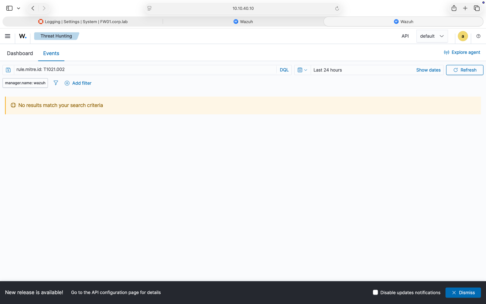

*No alert carries T1021.002.*

The command was still logged. Searching `data.win.eventdata.commandLine: *ADMIN$*` returned two alerts at 19:25:02: rule 92052 "Windows command prompt started by an abnormal process" at level 4 and rule 67027 "A process was created" at level 3.

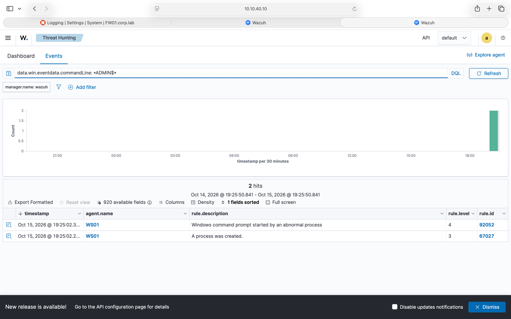

*Rules 92052 (level 4) and 67027 (level 3) carry the command line but not T1021.002.*

The query `data.win.eventdata.shareName: *ADMIN*` returned no results, so no share access event raised an alert. I did not check whether the audit policy for file shares is enabled.

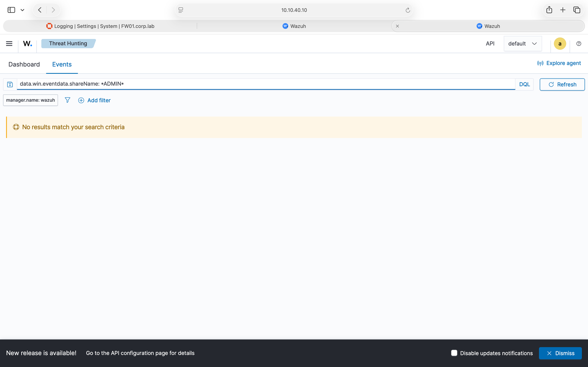

*No alert from a share access event.*

### Custom rules

Rules 100710 and 100711 match a command line that contains a UNC path to an administrative share, either `ADMIN$` or a drive share such as `C$`. 100710 is a child of the Sysmon event 1 group and 100711 is a child of rule 67027 for Security event 4688. Both are level 6 and map to T1021.002. Administrators use these paths legitimately, so the level is moderate.

```xml
<group name="local,windows,lateral_movement,">
  <rule id="100710" level="6">
    <if_group>sysmon_event1</if_group>
    <field name="win.eventdata.commandLine" type="pcre2">(?i)\\{2,4}[^\\\s]+\\{1,2}(admin|[a-z])\$(\\|\s|$)</field>
    <description>Sysmon: command line uses a Windows administrative share</description>
    <mitre><id>T1021.002</id></mitre>
  </rule>
  <rule id="100711" level="6">
    <if_sid>67027</if_sid>
    <field name="win.eventdata.commandLine" type="pcre2">(?i)\\{2,4}[^\\\s]+\\{1,2}(admin|[a-z])\$(\\|\s|$)</field>
    <description>Security 4688: command line uses a Windows administrative share</description>
    <mitre><id>T1021.002</id></mitre>
  </rule>
</group>
```

The first version of the pattern assumed single backslashes and returned no alerts after one run. The alert details show the command line with doubled backslashes, a form the first pattern cannot match, so I changed the pattern to accept one or two at each position. I later fed a real 100710 event to wazuh-logtest. The decoded fields confirm the stored form: every backslash in `win.eventdata.image` is doubled, and the UNC path in the command line has four backslashes before 127.0.0.1 and two before ADMIN$. I did not rerun the first version of the rule, so that it failed for this reason is still an inference from the pattern.

The same output shows that `>` and `&` in a command line are stored as `&gt;` and `&amp;`. The redirect in this test reads `1&gt;` in the decoded field. A rule that matches a redirect or an ampersand has to use the escaped form. wazuh-logtest decoded the event with the generic json decoder and did not run the Windows rules, so I used it only to read the stored field values.

### Result: after the custom rules

I ran the test again. The query `rule.id: (100710 or 100711)` returned two alerts on WS01, both level 6: rule 100711 "Security 4688: command line uses a Windows administrative share" at 19:30:52 and rule 100710 "Sysmon: command line uses a Windows administrative share" at 19:30:53.

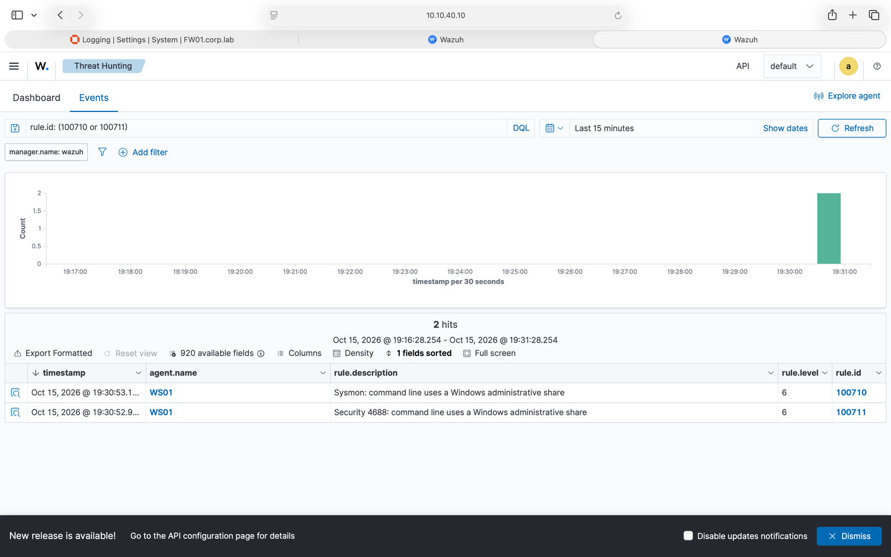

*Both custom rules fire at level 6.*

The alert details for rule 100710 show the Sysmon event 1 for `cmd.exe` with `rule.mitre.id` T1021.002, tactic Lateral Movement, technique SMB/Windows Admin Shares. The command line is shown with doubled backslashes, as `\\\\127.0.0.1\\ADMIN$\\output.txt`. The event's own time is 23:30:48 UTC (19:30:48 local) and Wazuh stamped the alert at 19:30:53.

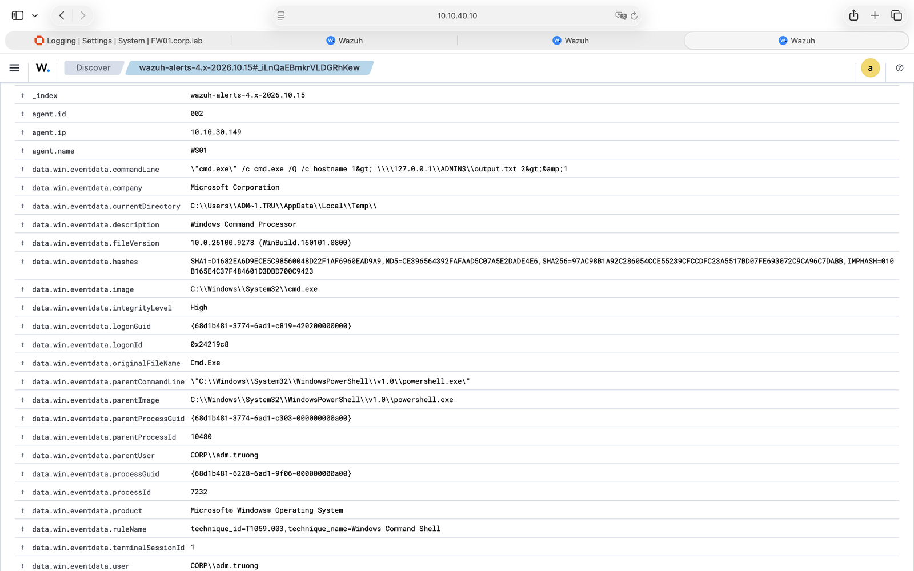

*Event data of the rule 100710 alert: the cmd.exe command line and its PowerShell parent.*

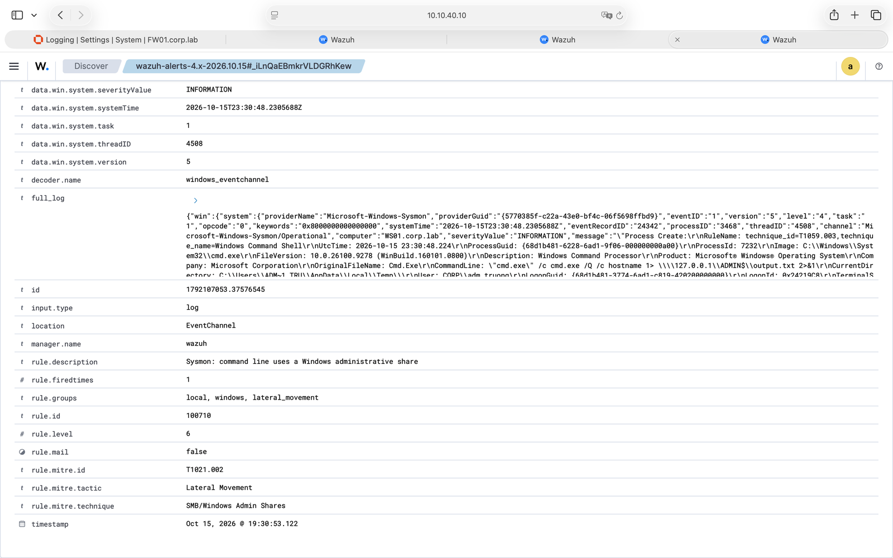

*Rule fields of the same alert: level 6, T1021.002, Lateral Movement.*

### Limitations

- The alert details were inspected for rule 100710 only, not for rule 100711.
- The share was the local one through the loopback address. No remote host such as DC01 was tested, so no network connection to another machine was involved.
- Share access events 5140 and 5145 raised no alert, and whether Windows logs them was not checked.
- Any legitimate use of an administrative share in a command line will also match.

## T1543.003 Windows Service

The test was Atomic T1543.003-2, which creates a service with `sc.exe create AtomicTestService_CMD binPath= "C:\AtomicRedTeam\atomics\T1543.003\bin\AtomicService.exe" start=auto type=Own` and then starts it with `sc.exe start`. The binary is a harmless test service from the Atomic Red Team repository, and it was already on disk. I ran it from an elevated PowerShell on WS01. The output showed `CreateService SUCCESS` and the service in `START_PENDING` with exit code 0, so Defender did not block it. I skipped the TinyTurla test because it imitates a real backdoor.

### Result: coverage by default rules

The query `rule.mitre.id: T1543.003` returned two alerts on WS01. Rule 92307 "Evidence of new service creation found in registry under HKLM\System\CurrentControlSet\Services..." at level 3 came at 19:38:47, and rule 61138 "New Windows Service Created" at level 5 came at 19:38:48. Both match the technique query, so both carry T1543.003. No custom rule was needed.

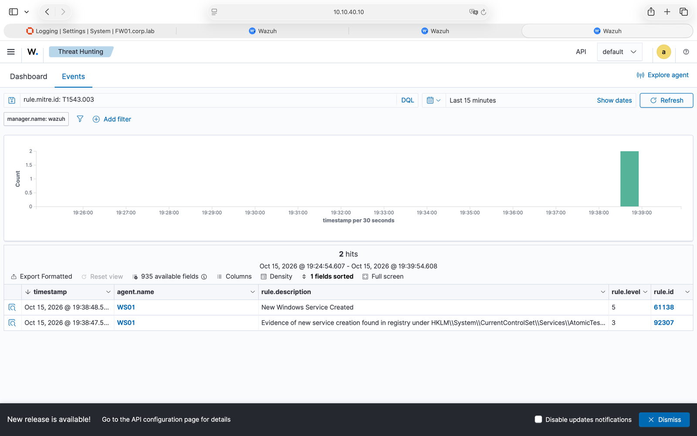

*Rules 92307 (level 3) and 61138 (level 5) carry T1543.003.*

The query `data.win.system.eventID: 7045` returned the same rule 61138 alert, which is the System log event for a new service.

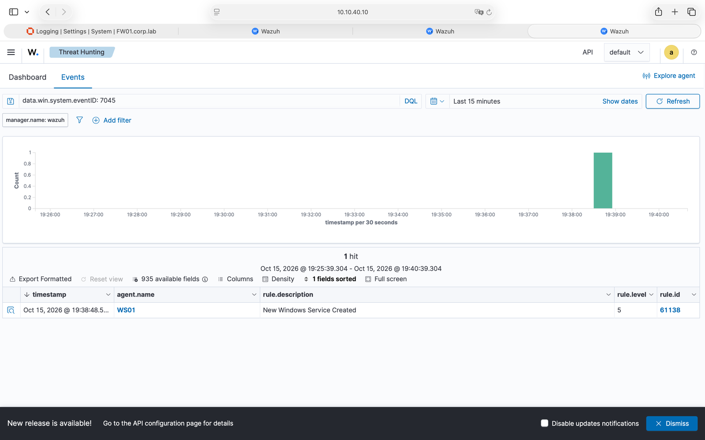

*The event 7045 query returns rule 61138 at level 5.*

Searching `data.win.eventdata.commandLine: *AtomicTestService_CMD*` returned six more alerts between 19:38:45 and 19:38:47 that carry the command but not the technique: rule 67027 three times at level 3, rule 92052 "Windows command prompt started by an abnormal process" at level 4, and rule 92032 "Suspicious Windows cmd shell execution" twice at level 3.

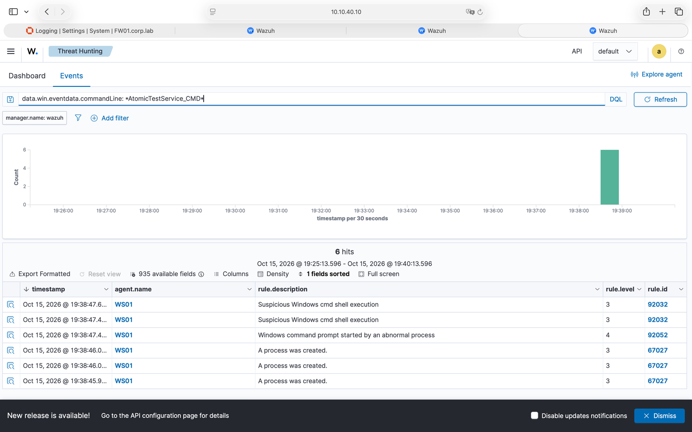

*Six generic alerts at levels 3 and 4 carry the command line.*

### Limitations

- I did not open the alert details, so the technique match comes from the query result.
- The alerts are level 5 and level 3. Whether that is enough to page an analyst depends on the alerting threshold.
- Only service creation with `sc.exe` was tested. PowerShell service creation, modifying an existing service and remote service installation were not run.
- The service binary sat in the Atomic Red Team folder. I did not test whether a service pointing at a user writable path would be rated higher.

## T1218 System Binary Proxy Execution

The test was Atomic T1218-16, which uses the Windows binary `wlrmdr.exe` to launch another program. The command line was `powershell.exe & {wlrmdr.exe -s 3600 -f 0 -t _ -m _ -a 11 -u "C:\Windows\System32\calc.exe"}`. I ran it from PowerShell on WS01. The output ended with `Done executing test: T1218-16 System Binary Proxy Execution - Wlrmdr Lolbin` and exit code 0.

### Result: default rules

I ran the test once before writing any rule. Wazuh raised only generic alerts, such as rule 92027 at level 4 for the Sysmon event, and none of them carried T1218. The technique was not detected out of the box.

### Custom rules

Rules 100720 and 100721 match a command line where `wlrmdr.exe` is followed by the `-u` option, which is the option that launches the target program. 100720 reads Sysmon event 1 and 100721 reads Security event 4688. Both are level 8 and map to T1218.

```xml
<group name="local,windows,defense_evasion,">
  <rule id="100720" level="8">
    <if_group>sysmon_event1</if_group>
    <field name="win.eventdata.commandLine" type="pcre2">(?i)wlrmdr(\.exe)?\W.*[-/]u(\s|$)</field>
    <description>Sysmon: wlrmdr.exe used to launch another program</description>
    <mitre><id>T1218</id></mitre>
  </rule>
  <rule id="100721" level="8">
    <if_sid>67027</if_sid>
    <field name="win.eventdata.commandLine" type="pcre2">(?i)wlrmdr(\.exe)?\W.*[-/]u(\s|$)</field>
    <description>Security 4688: wlrmdr.exe used to launch another program</description>
    <mitre><id>T1218</id></mitre>
  </rule>
</group>
```

### Result: after the custom rules

The rule file passed `wazuh-analysisd -t` with exit code 0. After restarting the manager I ran the test again. The query `rule.id: (100720 or 100721)` over the last 15 minutes returned one hit when I ran it right after the test: rule 100721 (Security 4688) at level 8 on WS01 at 19:48:27.

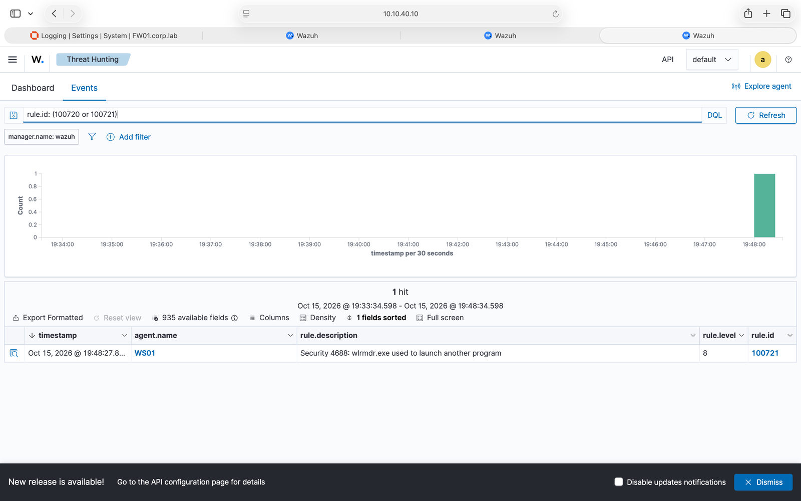

*The first query, run seconds after the test, showed one hit from rule 100721. The Sysmon alert was not indexed yet**.*

Alerts for Sysmon events took longer to appear than the Security ones. About seven minutes later I searched `data.win.eventdata.commandLine: *wlrmdr*` on the Sysmon provider over the last 60 minutes. It returned two hits. Rule 100720 (Sysmon event 1) at level 8 came at 19:48:28, from the second run. Rule 92027 "Powershell process spawned powershell instance" at level 4 came at 19:45:56, from the first run before the custom rules.

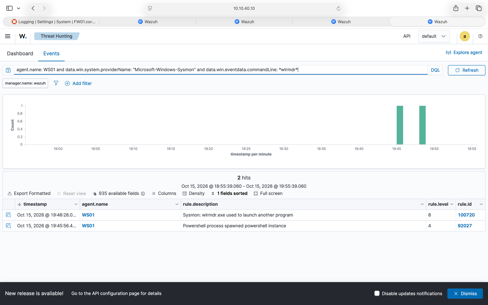

*Both rules on the Sysmon event: 100720 for the run with custom rules, 92027 for the baseline run.*

The Sysmon event itself was logged at 23:48:20.731Z for powershell.exe, with the wlrmdr call in its CommandLine. Sysmon tagged it with its own rule name T1059.001, not T1218.

The Security log shows the whole chain. At 19:48:20 powershell.exe started, a second later powershell.exe created `wlrmdr.exe`, and in the same second `wlrmdr.exe` created `calc.exe`. So the proxy execution did happen. The first run, before the custom rules, logged three event 4688 entries too, at 19:45:47 and twice at 19:45:48, but I did not inspect their process names.

In the Sysmon event 1 search for wlrmdr over the last hour, only the two PowerShell events appeared. That means Sysmon did not log the `wlrmdr.exe` or `calc.exe` process creation, and I did not investigate why.

The alert details show `rule.mitre.id` T1218, tactic Defense Evasion and technique System Binary Proxy Execution. The Security event was logged at 23:48:20Z (19:48:20 local time) for user CORP\adm.truong, with powershell.exe as both the new process and its parent. The command line contains the full `wlrmdr.exe` call.

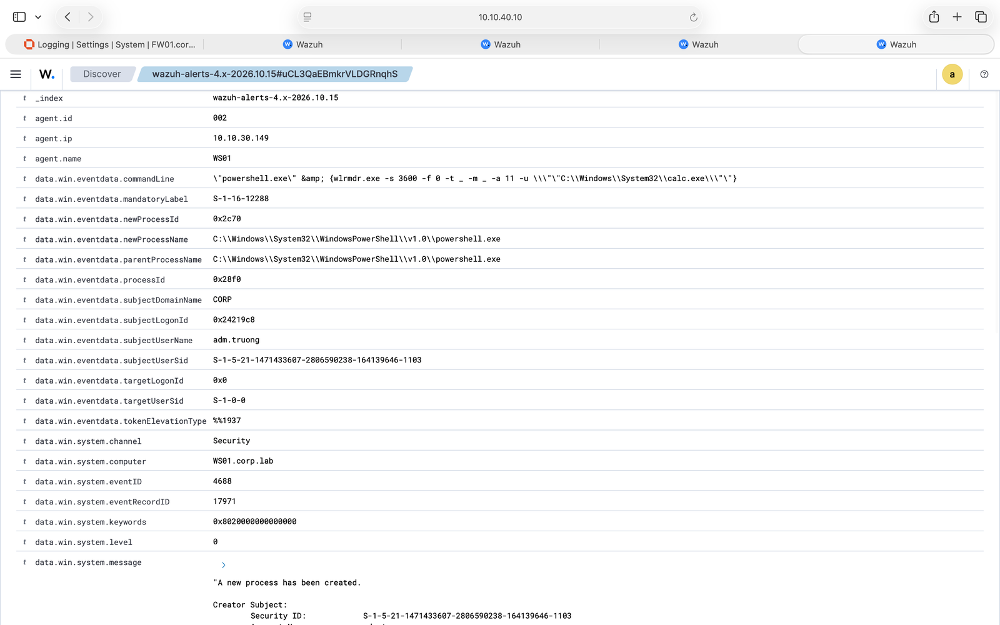

*The command line and process fields of the 100721 alert.*


*Rule 100721 with T1218, Defense Evasion and System Binary Proxy Execution.*

### Rule 100722: child of wlrmdr.exe

The Security log records `calc.exe` with `wlrmdr.exe` as its creator, so I added rule 100722. It alerts on any Security event 4688 whose parent process is `wlrmdr.exe`. It reads the process that was started, so it does not depend on the command line of the launcher.

```xml
<group name="local,windows,defense_evasion,">
  <rule id="100722" level="8">
    <if_sid>67027</if_sid>
    <field name="win.eventdata.parentProcessName" type="pcre2">(?i)\\wlrmdr\.exe$</field>
    <description>Security 4688: process started by wlrmdr.exe</description>
    <mitre><id>T1218</id></mitre>
  </rule>
</group>
```

The rule file passed `wazuh-analysisd -t` with exit code 0. After restarting the manager I ran the test again. A query over the last 15 minutes for the T1218 rules and the other custom rules returned 100722 at 22:12:49, next to 100721 at 22:12:44 and 22:12:49 and 100720 at 22:12:44. Rule 100721 alerted twice per run. My guess is the launcher and the `wlrmdr.exe` process itself, but I did not open them to confirm.


*The T1218 test raised 100720, 100721 and the new 100722. The net commands in the same window raised one hit each from 100600 and 100601 (first fix).*

### Limitations

- I opened the alert details for rule 100721 only, so the technique field of rule 100720 comes from its definition, not from an alert I inspected.
- The regex needs `wlrmdr.exe` followed by `-u` or `/u`. Other wlrmdr options and a renamed copy of the binary were not tested.
- A public Sigma rule treats `winlogon.exe` as the normal parent of `wlrmdr.exe`. I did not baseline that, so rules 100720 and 100721 may alert on normal Windows use of `wlrmdr.exe` with `-u`.
- The alert details for rule 100722 were not opened, so its technique field comes from its definition.
- Rules 100720 and 100721 match the command line of the launcher. Rule 100722 matches the child process, but only in the Security log, because Sysmon did not log wlrmdr.exe or calc.exe in this test.
- The baseline run has no screenshot of its own. The 92027 alert in the last screenshot is the only trace of it, and it does not show whether other rules fired.
- Only this one binary was tested. Other proxy execution binaries such as `mshta.exe`, `rundll32.exe` and `regsvr32.exe` are not covered by any rule written here.
- Level 8 is mid range. Whether it pages an analyst depends on the alerting threshold.

## Check with harmless commands

To see whether the custom rules alert on near misses, I ran these commands on WS01 in one batch together with the T1218 test, at about 22:12:

- `schtasks /query /fo LIST`
- `wevtutil qe Application /c:1 /f:text`
- `certutil -hashfile C:\Windows\System32\notepad.exe SHA256`
- `cmd.exe /c echo \\server\share\file.txt`
- `cmd.exe /c echo wlrmdr`

The query covered rules 100500, 100550, 100551, 100600, 100601, 100700, 100701, 100710, 100711, 100720, 100721 and 100722 over the last 15 minutes. It returned only the hits expected from the test commands: 100600 and 100601 for the net commands, and 100720, 100721 and 100722 for the wlrmdr test. None of the five harmless commands above raised an alert from the rules built for them.

### Limitations

- This is one pass with a few commands, not a baseline of normal activity over days.
- The harmless commands match the hardest cases I thought of, but they are not a measured false positive rate.

## Renamed binaries

Rules 100100, 100500 and 100550 match the image path, so a copy of the tool under another name does not alert. A review of the rule file flagged this as the simplest way around them.

### Test

On WS01 I copied `systeminfo.exe`, `schtasks.exe` and `wevtutil.exe` to a temp folder as `sysq.exe`, `stq.exe` and `wvq.exe`, ran each one, and also ran a real `schtasks -create` command. Sysmon event 1 and Security event 4688 recorded every run. The Sysmon events carry the original names in `OriginalFileName`: `sysinfo.exe`, `schtasks.exe` and `wevtutil.exe`.

The first query returned no alerts. The manager status showed it had been running since 22:20, before I added the rules, so they were not loaded. The old pattern in rule 100500 also accepted only `/create`, and `schtasks.exe` accepts `-create` too. Events already logged are not evaluated again, so I restarted the manager and ran the test again.

### Rules

```xml
<group name="local,windows,renamed_binary,">
  <rule id="100101" level="8">
    <if_group>sysmon_event1</if_group>
    <field name="win.eventdata.originalFileName" type="pcre2">(?i)^(sysinfo|systeminfo)\.exe$</field>
    <field name="win.eventdata.image" type="pcre2" negate="yes">(?i)\\systeminfo\.exe$</field>
    <description>Sysmon: systeminfo.exe running under a different file name (masquerading)</description>
    <mitre>
      <id>T1082</id>
      <id>T1036.003</id>
    </mitre>
    <group>discovery,defense_evasion,</group>
  </rule>

  <rule id="100501" level="8">
    <if_group>sysmon_event1</if_group>
    <field name="win.eventdata.originalFileName" type="pcre2">(?i)^schtasks\.exe$</field>
    <field name="win.eventdata.image" type="pcre2" negate="yes">(?i)\\schtasks\.exe$</field>
    <field name="win.eventdata.commandLine" type="pcre2">(?i)\s[-/]create(\s|$)</field>
    <description>Sysmon: scheduled task created via renamed schtasks.exe (Persistence, masquerading)</description>
    <mitre>
      <id>T1053.005</id>
      <id>T1036.003</id>
    </mitre>
    <group>persistence,defense_evasion,</group>
  </rule>

  <rule id="100552" level="8">
    <if_group>sysmon_event1</if_group>
    <field name="win.eventdata.originalFileName" type="pcre2">(?i)^wevtutil\.exe$</field>
    <field name="win.eventdata.image" type="pcre2" negate="yes">(?i)\\wevtutil\.exe$</field>
    <field name="win.eventdata.commandLine" type="pcre2">(?i)\s(cl|clear-log)\s</field>
    <description>Sysmon: event log cleared via renamed wevtutil.exe (masquerading)</description>
    <mitre>
      <id>T1070.001</id>
      <id>T1036.003</id>
    </mitre>
    <group>defense_evasion,</group>
  </rule>
</group>
```

Rule 100500 now accepts `-create` as well as `/create`. The three new rules match the original file name and skip events where the image already ends in the tool's own name, so a normal run still alerts once, from the original rule.

### Result

`wazuh-analysisd -t` returned exit code 0 and the manager restarted at 22:44:18. The query `rule.id: (100100 or 100101 or 100500 or 100501 or 100550 or 100552)` over the last 15 minutes returned four level 8 alerts on WS01: rule 100101 at 22:44:39, then rules 100501, 100500 and 100552 at 22:44:43. Rule 100500 matched the real `schtasks -create`, and rule 100501 matched the renamed `stq.exe`. Rules 100100 and 100550 did not fire for the renamed copies.


Four level 8 alerts, one per rule, with no hit from 100100 or 100550.

### Limitations

- I checked the alert list only. I did not open the alert details to confirm the technique fields of rules 100101, 100501 and 100552.
- The rules trust `OriginalFileName`, which comes from the file's version resource. I did not test a copy with a modified resource.
- Only these three tools are covered. The other custom rules still match on the image path or on command line text alone.
- Sysmon recorded `sysinfo.exe` for the `systeminfo.exe` copy. The pattern of rule 100101 also accepts `systeminfo.exe` in case another Windows build reports that name.
- I ran the real `schtasks.exe` in this test but not the real `systeminfo.exe` or `wevtutil.exe`, so I only saw the original and renamed rules stay separate for schtasks.
